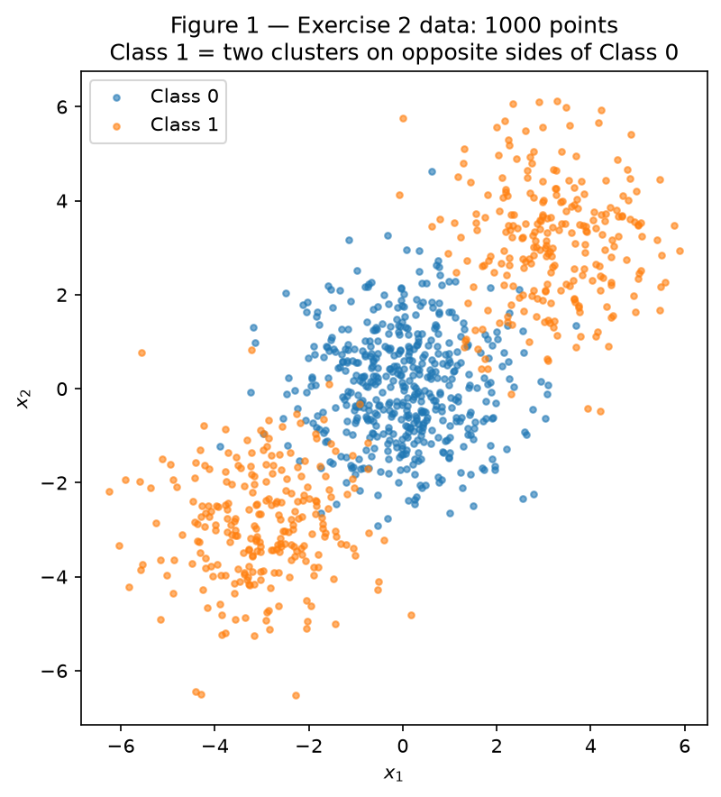
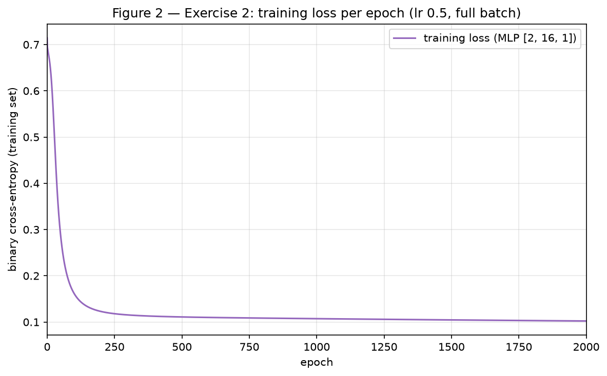
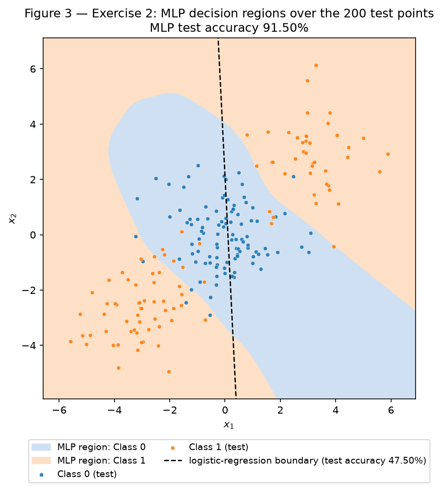
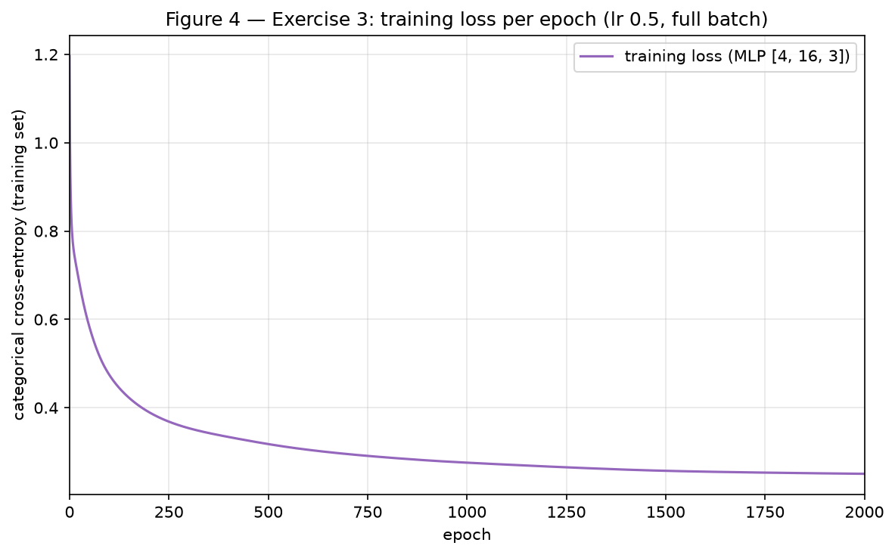
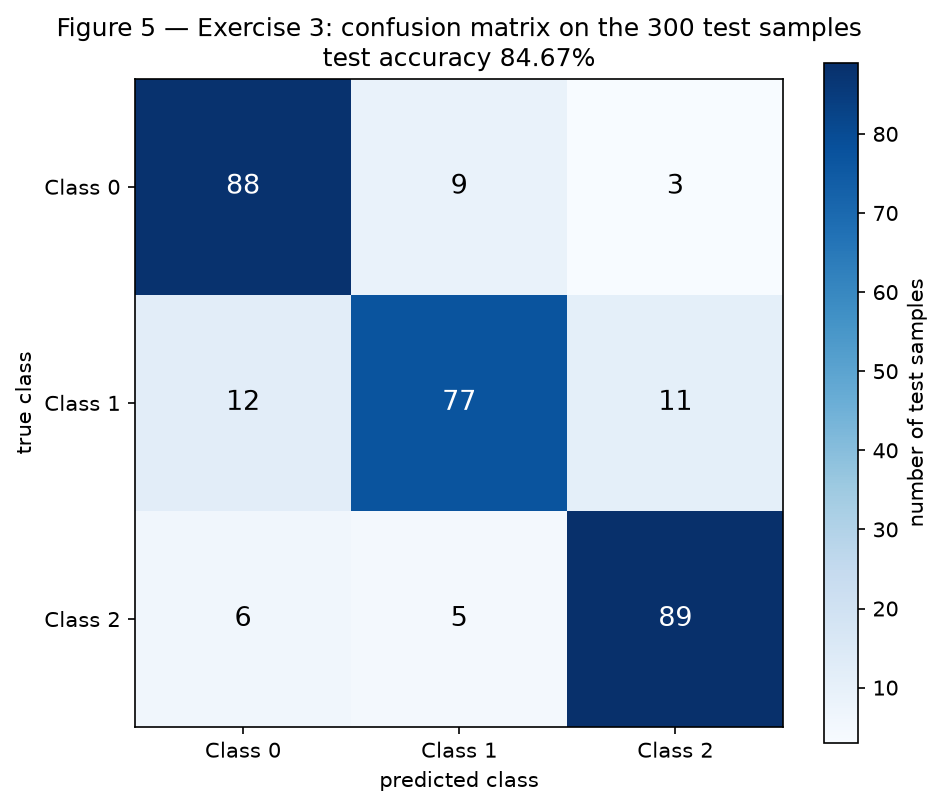
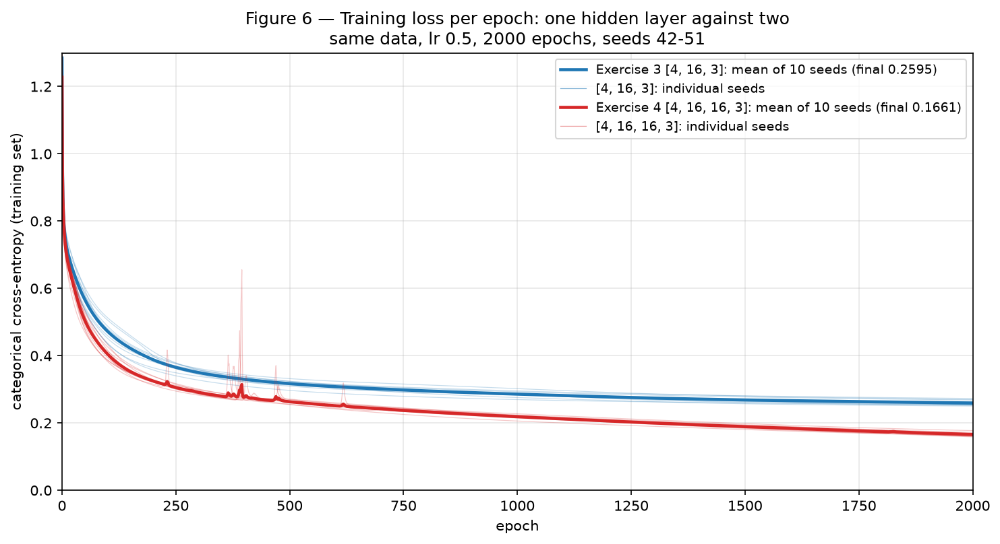

# MLP — Understanding Multi-Layer Perceptrons

One step of backpropagation worked by hand, then a multi-layer perceptron written from scratch with NumPy and trained on three problems: two classes that no straight line separates, three classes with two clusters each, and the same three classes with a second hidden layer. No neural-network library is used: the activations, the losses, the forward pass, every gradient and the update are in `code/mlp.py`. scikit-learn is used only to generate and split the datasets (`make_blobs`, `make_classification`, `train_test_split`), for the logistic-regression baselines the statement allows, and for the confusion matrix.

**Approach.** The code is split into files under `code/`: `mlp.py` (the network and its losses, written once), `common.py` (settings, the two datasets and plotting helpers), `exercise1.py` to `exercise4.py` (the experiments), `gradient_check.py` (a finite-difference check of the backward pass) and `main.py`, which runs everything and writes `results/results.json`; `check_report.py` then confirms that the numbers of this report match that file. Every number and figure in this report is reproduced by installing `requirements.txt` and running, from the repository root:

```
python docs/exercises/mlp/code/main.py
python docs/exercises/mlp/code/check_report.py
```

**Seeds.** Every network starts from `rng = np.random.default_rng(42)`, created afresh for each training run, so that the Exercise 3 and Exercise 4 networks start from literally the same seed, as Exercise 4 requires; the datasets and the train/test splits use `random_state=42`. Exercise 4 repeats the comparison with the generators of seeds 42 to 51.

**Training.** All three trained networks use the same recipe: tanh hidden layers, LeCun-normal initialization (weights drawn from N(0, 1/fan-in), biases zero), and full-batch gradient descent, one update per epoch over the whole training set, with learning rate 0.5 for 2000 epochs. The recipe was fixed before the comparisons were run and is never tuned per exercise.

**Challenges.**

- *One network for every task.* Exercises 2, 3 and 4 must reuse the same forward pass, backward pass and update. The loss is therefore an object passed to the network: it turns the output pre-activation into a prediction and supplies ∂L/∂u, the only place where the tasks differ. Even Exercise 1 is checked with the same class, with a tanh output and the squared error.
- *Trusting hand-derived gradients.* `gradient_check.py` compares every analytic gradient with a central finite difference, for all three losses, on networks with two hidden layers. The largest relative error is 6.6 × 10⁻⁸.
- *A fair depth comparison.* The deeper network changes depth and nothing else: same data, split, loss, learning rate, epochs, initialization rule and seeds, and ten seeds instead of one, because a single seed points the wrong way here.

``` python title="code/main.py"
--8<-- "docs/exercises/mlp/code/main.py"
```

## Exercise 1

*One step of backpropagation, by hand.*

The network has 2 inputs, one hidden layer of 2 tanh neurons and 1 tanh output, with the squared error on one sample, L = (y − ŷ)². The values of the statement are

$$
\begin{aligned}
\mathbf{x} &= \begin{bmatrix} 0.5 \\ -0.2 \end{bmatrix},\qquad y = 1.0,\qquad \eta = 0.3, \\
\mathbf{W}^{(1)} &= \begin{bmatrix} 0.3 & -0.1 \\ 0.2 & 0.4 \end{bmatrix},\qquad \mathbf{b}^{(1)} = \begin{bmatrix} 0.1 \\ -0.2 \end{bmatrix}, \\
\mathbf{W}^{(2)} &= \begin{bmatrix} 0.5 & -0.3 \end{bmatrix},\qquad b^{(2)} = 0.2 .
\end{aligned}
$$

Every number below is computed by hand and shown to 6 decimal places; each step uses the unrounded value of the previous one. `code/exercise1.py` runs the same network through the MLP code of the other exercises and prints every one of these numbers as a check.

### A — Forward pass

**Hidden pre-activations**, one row of W⁽¹⁾ per hidden neuron:

$$
\begin{aligned}
\mathbf{z}^{(1)} = \mathbf{W}^{(1)}\mathbf{x} + \mathbf{b}^{(1)} &= \begin{bmatrix} 0.3 \cdot 0.5 + (-0.1)(-0.2) + 0.1 \\ 0.2 \cdot 0.5 + 0.4 \cdot (-0.2) + (-0.2) \end{bmatrix} \\
&= \begin{bmatrix} 0.15 + 0.02 + 0.1 \\ 0.10 - 0.08 - 0.2 \end{bmatrix} = \begin{bmatrix} 0.270000 \\ -0.180000 \end{bmatrix}
\end{aligned}
$$

**Hidden activations:**

$$
\mathbf{h}^{(1)} = \tanh(\mathbf{z}^{(1)}) = \begin{bmatrix} \tanh(0.27) \\ \tanh(-0.18) \end{bmatrix} = \begin{bmatrix} 0.263625 \\ -0.178081 \end{bmatrix}
$$

**Output pre-activation:**

$$
\begin{aligned}
u^{(2)} = \mathbf{W}^{(2)}\mathbf{h}^{(1)} + b^{(2)} &= 0.5 \cdot 0.263625 + (-0.3)(-0.178081) + 0.2 \\
&= 0.131812 + 0.053424 + 0.2 = 0.385237
\end{aligned}
$$

**Output and loss:**

$$
\begin{aligned}
\hat{y} &= \tanh(0.385237) = 0.367247, \\
L &= (y - \hat{y})^2 = (1 - 0.367247)^2 = 0.632753^2 = 0.400377
\end{aligned}
$$

### B — Backward pass

The chain starts at the loss and moves one link at a time towards the input. Two facts are used throughout: d tanh(a)/da = 1 − tanh²(a), and every bias enters its layer with an input of 1.

**1. Loss with respect to the output.** From L = (y − ŷ)²:

$$
\frac{\partial L}{\partial \hat{y}} = -2\,(y - \hat{y}) = -2 \cdot 0.632753 = -1.265507
$$

**2. Through the output tanh.** Since ŷ = tanh(u⁽²⁾), ∂ŷ/∂u⁽²⁾ = 1 − ŷ² = 1 − 0.134870 = 0.865130, and

$$
\delta^{(2)} = \frac{\partial L}{\partial u^{(2)}} = \frac{\partial L}{\partial \hat{y}} \cdot \frac{\partial \hat{y}}{\partial u^{(2)}} = -1.265507 \cdot 0.865130 = -1.094828
$$

**3. Output layer.** u⁽²⁾ = W⁽²⁾₁ h₁ + W⁽²⁾₂ h₂ + b⁽²⁾, so ∂u⁽²⁾/∂W⁽²⁾ⱼ = hⱼ and ∂u⁽²⁾/∂b⁽²⁾ = 1:

$$
\begin{aligned}
\frac{\partial L}{\partial \mathbf{W}^{(2)}} &= \delta^{(2)}\,\mathbf{h}^{(1)\top} = -1.094828 \cdot \begin{bmatrix} 0.263625 & -0.178081 \end{bmatrix} \\
&= \begin{bmatrix} -0.288624 & 0.194968 \end{bmatrix}, \\
\frac{\partial L}{\partial b^{(2)}} &= \delta^{(2)} = -1.094828
\end{aligned}
$$

**4. Back to the hidden activations.** Each hᵢ reaches u⁽²⁾ through its weight W⁽²⁾ᵢ, so ∂u⁽²⁾/∂hᵢ = W⁽²⁾ᵢ:

$$
\frac{\partial L}{\partial \mathbf{h}^{(1)}} = \delta^{(2)}\,\mathbf{W}^{(2)\top} = -1.094828 \cdot \begin{bmatrix} 0.5 \\ -0.3 \end{bmatrix} = \begin{bmatrix} -0.547414 \\ 0.328448 \end{bmatrix}
$$

**5. Through the hidden tanh.** With 1 − h₁² = 1 − 0.069498 = 0.930502 and 1 − h₂² = 1 − 0.031713 = 0.968287, element by element:

$$
\begin{aligned}
\delta^{(1)} = \frac{\partial L}{\partial \mathbf{z}^{(1)}} &= \frac{\partial L}{\partial \mathbf{h}^{(1)}} \odot \left(1 - \mathbf{h}^{(1)} \odot \mathbf{h}^{(1)}\right) \\
&= \begin{bmatrix} -0.547414 \cdot 0.930502 \\ 0.328448 \cdot 0.968287 \end{bmatrix} = \begin{bmatrix} -0.509370 \\ 0.318032 \end{bmatrix}
\end{aligned}
$$

**6. Hidden layer.** zᵢ = W⁽¹⁾ᵢ₁ x₁ + W⁽¹⁾ᵢ₂ x₂ + b⁽¹⁾ᵢ, so ∂zᵢ/∂W⁽¹⁾ᵢⱼ = xⱼ and ∂zᵢ/∂b⁽¹⁾ᵢ = 1. The weight gradient is the outer product of the deltas with the input:

$$
\begin{aligned}
\frac{\partial L}{\partial \mathbf{W}^{(1)}} &= \delta^{(1)}\,\mathbf{x}^{\top} = \begin{bmatrix} -0.509370 \cdot 0.5 & -0.509370 \cdot (-0.2) \\ 0.318032 \cdot 0.5 & 0.318032 \cdot (-0.2) \end{bmatrix} \\
&= \begin{bmatrix} -0.254685 & 0.101874 \\ 0.159016 & -0.063606 \end{bmatrix}, \\
\frac{\partial L}{\partial \mathbf{b}^{(1)}} &= \delta^{(1)} = \begin{bmatrix} -0.509370 \\ 0.318032 \end{bmatrix}
\end{aligned}
$$

The signs say what the update will do. δ⁽²⁾ < 0 means that raising u⁽²⁾ lowers the loss, which is right: ŷ = 0.367247 is below the target 1. Through W⁽²⁾ = [0.5, −0.3], the first hidden neuron should therefore move up and the second down, which is exactly the sign pattern of δ⁽¹⁾. The hidden deltas are also smaller than the output delta, |δ⁽¹⁾| = 0.509370 and 0.318032 against |δ⁽²⁾| = 1.094828: on the way back, the output delta is multiplied by a weight (0.5 or −0.3) and by a tanh derivative (0.930502 or 0.968287).

### C — Parameter update

Gradient descent, p ← p − η ∂L/∂p with η = 0.3, applied to every weight and bias:

$$
\begin{aligned}
\mathbf{W}^{(2)} &\leftarrow \begin{bmatrix} 0.5 & -0.3 \end{bmatrix} - 0.3 \begin{bmatrix} -0.288624 & 0.194968 \end{bmatrix} \\
&= \begin{bmatrix} 0.5 + 0.086587 & -0.3 - 0.058490 \end{bmatrix} = \begin{bmatrix} 0.586587 & -0.358490 \end{bmatrix}
\end{aligned}
$$

$$
b^{(2)} \leftarrow 0.2 - 0.3 \cdot (-1.094828) = 0.2 + 0.328448 = 0.528448
$$

$$
\begin{aligned}
\mathbf{W}^{(1)} &\leftarrow \begin{bmatrix} 0.3 & -0.1 \\ 0.2 & 0.4 \end{bmatrix} - 0.3 \begin{bmatrix} -0.254685 & 0.101874 \\ 0.159016 & -0.063606 \end{bmatrix} \\
&= \begin{bmatrix} 0.3 + 0.076405 & -0.1 - 0.030562 \\ 0.2 - 0.047705 & 0.4 + 0.019082 \end{bmatrix} = \begin{bmatrix} 0.376405 & -0.130562 \\ 0.152295 & 0.419082 \end{bmatrix}
\end{aligned}
$$

$$
\begin{aligned}
\mathbf{b}^{(1)} &\leftarrow \begin{bmatrix} 0.1 \\ -0.2 \end{bmatrix} - 0.3 \begin{bmatrix} -0.509370 \\ 0.318032 \end{bmatrix} \\
&= \begin{bmatrix} 0.1 + 0.152811 \\ -0.2 - 0.095410 \end{bmatrix} = \begin{bmatrix} 0.252811 \\ -0.295410 \end{bmatrix}
\end{aligned}
$$

| Parameter | Before | Gradient | After |
|---|---|---|---|
| W⁽¹⁾₁₁ | 0.3 | −0.254685 | **0.376405** |
| W⁽¹⁾₁₂ | −0.1 | 0.101874 | **−0.130562** |
| W⁽¹⁾₂₁ | 0.2 | 0.159016 | **0.152295** |
| W⁽¹⁾₂₂ | 0.4 | −0.063606 | **0.419082** |
| b⁽¹⁾₁ | 0.1 | −0.509370 | **0.252811** |
| b⁽¹⁾₂ | −0.2 | 0.318032 | **−0.295410** |
| W⁽²⁾₁ | 0.5 | −0.288624 | **0.586587** |
| W⁽²⁾₂ | −0.3 | 0.194968 | **−0.358490** |
| b⁽²⁾ | 0.2 | −1.094828 | **0.528448** |

**Would the loss go up or down on a second forward pass? Down.** Every parameter moved against its own gradient, so to first order the change of the loss is the sum of −η (∂L/∂p)² over all parameters: −η ‖∇L‖² = −0.3 · 1.785141 = −0.535542, negative whatever the gradients are. The step is not small, so this first-order estimate overshoots, but the loss still falls. Repeating the forward pass with the updated parameters gives z⁽¹⁾ = [0.4671, −0.3031], h⁽¹⁾ = [0.4359, −0.2941], u⁽²⁾ = 0.8896, ŷ = 0.7112 and **L = 0.0834**, down from 0.4004. A step this size cannot overshoot the target here: ŷ moved from 0.3672 to 0.7112, towards y = 1 but not past it, and a tanh output can never exceed 1. The lecture's sigmoid example shows the same: one step lowers its loss from 0.525 to 0.407.

### Code

``` python title="code/exercise1.py"
--8<-- "docs/exercises/mlp/code/exercise1.py"
```

``` python title="code/gradient_check.py"
--8<-- "docs/exercises/mlp/code/gradient_check.py"
```

## Exercise 2

*Binary classification that a straight line cannot do.*

### A — Generate the data

The data is generated exactly as given: `make_blobs` with centers (0, 0), (3, 3) and (−3, −3), 500/250/250 samples, `cluster_std=1.2` and `random_state=42`. Class 1 is made of the two outer clusters, so each class has 500 points. `train_test_split(..., test_size=0.2, random_state=42, stratify=y)` gives 800 training and 200 test points, both exactly 50.00% Class 1.


/// caption
Figure 1 — The 1000 points of Exercise 2, colored by class: Class 0 is the middle cluster, Class 1 the two clusters on either side of it.
///

### B — Establish the baseline

A logistic regression (`sklearn.linear_model.LogisticRegression`, default settings) fitted to the training set scores **47.50%** on the test set: worse than guessing. Item D explains why.

### C — Implement the MLP

The network is the class `MLP` in `code/mlp.py`. It takes the layer sizes and the loss as arguments, `MLP(layer_sizes, loss, rng)`, so the same code builds any depth and width:

- **Forward pass.** Each layer computes Z = A W⁽ˡ⁾ᵀ + b⁽ˡ⁾ for a batch A with one sample per row; W⁽ˡ⁾ has one row per receiving neuron, as in the lecture. Hidden layers apply tanh, and the last layer returns its pre-activation U to the loss.

- **Loss.** Here the loss is binary cross-entropy with a sigmoid output, p = σ(u), averaged over the N training samples:

    $$ L = -\frac{1}{N}\sum_{n=1}^{N} \Big[ y_n \log p_n + (1 - y_n) \log(1 - p_n) \Big]. $$

    The code evaluates it in the equivalent form log(1 + eᵘ) − y u, which never takes the log of 0.

- **Backward pass**, derived by hand. Since dσ/du = p(1 − p), the output error is

    $$ \frac{\partial L}{\partial u_n} = \frac{1}{N}\left(-\frac{y_n}{p_n} + \frac{1 - y_n}{1 - p_n}\right) p_n (1 - p_n) = \frac{p_n - y_n}{N}. $$

    From there, for every layer l going backwards, with δ⁽ˡ⁾ = ∂L/∂Z⁽ˡ⁾ (one row per sample) and A⁽ˡ⁻¹⁾ the input of layer l:

    $$
    \begin{aligned}
    \frac{\partial L}{\partial \mathbf{W}^{(l)}} &= \delta^{(l)\top} \mathbf{A}^{(l-1)}, \qquad \frac{\partial L}{\partial \mathbf{b}^{(l)}} = \sum_{n} \delta^{(l)}_n, \\
    \delta^{(l-1)} &= \left(\delta^{(l)} \mathbf{W}^{(l)}\right) \odot \left(1 - \mathbf{A}^{(l-1)} \odot \mathbf{A}^{(l-1)}\right).
    \end{aligned}
    $$

    These are the six steps of Exercise 1 written for a batch and any number of layers. `gradient_check.py` confirms them against finite differences, with a largest relative error of 6.6 × 10⁻⁸.

- **Update.** p ← p − η ∂L/∂p for every weight and bias (`step`). `fit` repeats forward, backward and update once per epoch on the whole training set, recording the training loss.

``` python title="code/mlp.py"
--8<-- "docs/exercises/mlp/code/mlp.py"
```

**Training and result.**

| Setting | Value |
|---|---|
| Architecture | **[2, 16, 1]**: 2 inputs, one hidden layer of 16 tanh units, 1 sigmoid output (65 parameters) |
| Loss | binary cross-entropy |
| Optimizer | full-batch gradient descent, learning rate **0.5** |
| Epochs | **2000** |
| Initialization | LeCun normal, seed 42 |
| Training loss | 0.7143 at epoch 0, 0.1617 at epoch 100, 0.1109 at epoch 500, 0.1022 at epoch 2000 |
| Accuracy | train 96.38%, **test 91.50%** (17 of 200 test points wrong) |


/// caption
Figure 2 — Training loss (binary cross-entropy) per epoch of the [2, 16, 1] network.
///


/// caption
Figure 3 — Decision regions of the MLP, evaluated on a 400 × 400 grid, with the 200 test points on top. The dashed line is the logistic-regression boundary of item B.
///

### D — Analysis

**What the MLP draws.** In Figure 3 the network assigns Class 0 to a **band** that crosses the plane diagonally between the two outer clusters, and Class 1 to the plane **on both sides** of it. Along the line through the three cluster centers, from (−6, −6) to (6, 6), the prediction goes Class 1 → Class 0 → Class 1. It changes at (−1.62, −1.62) and again at (1.59, 1.59), about halfway between the middle center and each outer one. The result is 91.50% on the test set, with 94.00% of the middle cluster, 90.48% of the upper-right cluster and 87.93% of the lower-left cluster correct. The remaining errors are points that lie well inside the other class's cloud, where the clusters overlap (Figure 1).

**Why no straight line can produce that region.** A linear classifier predicts Class 1 where w · x + b ≥ 0. On any straight path x(t) = a + t (c − a), the score w · x(t) + b = (w · a + b) + t w · (c − a) is a linear function of t, so it changes sign **at most once**. Every linear classifier therefore gives at most one switch along the diagonal, while the data needs two: Class 1 at both ends, Class 0 in the middle. Whatever its orientation, a line can put at most one of the two Class 1 clusters on its Class 1 side.

**Why the baseline falls below 50%, not merely below 90%.** The best a line can do is give up on one outer cluster. The best line, computed exactly over every way a line can split the points, scores 75.50% on the test set (74.25% on the training set). Logistic regression does not find it, because it minimizes the log-loss, not the error count. A line that isolates one outer cluster also labels the other outer cluster as Class 0, and those 250 points lie far from the line, so they would be wrong with high confidence; the log-loss of a confident mistake grows with its distance to the line. The log-loss minimum is therefore almost flat: the fitted weights are w = [0.0296, 0.0015] and b = −0.0031 (‖w‖ = 0.0297), and every test probability lies between 0.457 and 0.544. The boundary of this near-constant model is the nearly vertical dashed line through the middle of Figure 3. It cuts the middle cluster in half (53.00% correct) and puts one outer cluster on each side, so the upper-right cluster is 100.00% correct and the lower-left one 0.00%. That adds up to about half the test set, and the sample lands at 47.50%, slightly below a coin flip. The hidden layer is what turns this impossible "both ends" pattern into a band: each tanh unit draws one soft line, and the output combines several of them into a region that no single line can describe.

### Code

``` python title="code/exercise2.py"
--8<-- "docs/exercises/mlp/code/exercise2.py"
```

``` python title="code/common.py"
--8<-- "docs/exercises/mlp/code/common.py"
```

## Exercise 3

*Multi-class, same network.*

### A — Generate the data

The data is generated exactly as given: `make_classification` with 1500 samples, 4 informative features, 3 classes with 2 clusters each, `class_sep=1.0` and `random_state=42`. The split is 80/20, stratified, with the same seed: 1200 training samples (399/399/402 per class) and 300 test samples (100 per class).

### B — Adapt the network

**The adaptation is two arguments.** The network is built as `MLP([4, 16, 3], CategoricalCrossEntropy(3), rng)`, where Exercise 2 used `MLP([2, 16, 1], BinaryCrossEntropy(), rng)`. The output layer has 3 units, softmax turns them into probabilities, and categorical cross-entropy replaces binary cross-entropy. The forward pass, the backward pass, the update and the training loop (`forward`, `backward`, `step` and `fit` in `code/mlp.py`) are the same code, unchanged. Their only contact with the task is `loss.delta`, which supplies ∂L/∂u, and that has the same form, p − y, for both losses.

**Derivation of ∂L/∂u for softmax + cross-entropy.** For one sample with output pre-activations u₁, …, u_K, softmax gives

$$ p_k = \frac{e^{u_k}}{\sum_{m} e^{u_m}}, \qquad L = -\sum_{k} y_k \log p_k, $$

with y one-hot, so Σₖ yₖ = 1. Differentiating log pₖ = uₖ − log Σₘ e^{uₘ} with respect to uⱼ:

$$ \frac{\partial \log p_k}{\partial u_j} = \delta_{kj} - \frac{e^{u_j}}{\sum_m e^{u_m}} = \delta_{kj} - p_j , $$

where δₖⱼ is 1 when k = j and 0 otherwise. Then

$$ \frac{\partial L}{\partial u_j} = -\sum_k y_k \left(\delta_{kj} - p_j\right) = -y_j + p_j \sum_k y_k = p_j - y_j . $$

Averaged over N samples, the code uses ∂L/∂U = (P − Y)/N.

**Why it is so simple, and why that matters.** The log in the cross-entropy undoes the exponential in the softmax. In isolation, each factor has a complicated derivative: the softmax Jacobian pₖ(δₖⱼ − pⱼ) and the 1/pₖ of the log. In the product, the pₖ cancels and only "prediction minus target" survives. Binary cross-entropy with a sigmoid gives the same p − y (item 2C), because it is the two-class case of the same pair. Two consequences:

- The error signal is proportional to how wrong the prediction is, and it **does not vanish when the output saturates**. Pairing a softmax with the squared error would multiply the error by pₖ(1 − pₖ), which goes to 0 exactly when a confident prediction is wrong.
- One backward pass serves every task: the output layer always starts the chain with P − Y, which is what makes the verbatim reuse above possible.

### C — Train and evaluate

| Setting | Value |
|---|---|
| Architecture | **[4, 16, 3]**: 4 inputs, one hidden layer of 16 tanh units, 3 softmax outputs (131 parameters) |
| Loss | categorical cross-entropy |
| Optimizer | full-batch gradient descent, learning rate **0.5** |
| Epochs | **2000** |
| Initialization | LeCun normal, seed 42 |
| Training loss | 1.1963 at epoch 0, 0.3177 at epoch 500, 0.2504 at epoch 2000 |
| Accuracy | train 91.50%, **test 84.67%** (46 of 300 test samples wrong) |


/// caption
Figure 4 — Training loss (categorical cross-entropy) per epoch of the [4, 16, 3] network.
///


/// caption
Figure 5 — Confusion matrix on the 300 test samples (rows: true class, columns: predicted class).
///

### D — Analysis

**The most confused pair is Class 0 and Class 1.** According to Figure 5 they account for 21 of the 46 test errors: 9 Class 0 samples predicted as Class 1, and 12 the other way. Classes 1 and 2 account for 16 errors (11 + 5), Classes 0 and 2 for 9 (3 + 6).

**The explanation is where the six clusters sit.** `make_classification` places the cluster centers on vertices of a hypercube with side 2 · `class_sep` = 2 in the 4 informative dimensions, assigns cluster k to class k mod 3, and stretches every cluster by its own random linear map. The cluster of each sample can be recovered from the generator itself: with `shuffle=False` it returns the same samples, cluster by cluster. The measured centroids are indeed near ±1 in every coordinate:

| Cluster | Class | Centroid (4D) | RMS radius |
|---|---|---|---|
| 0 | 0 | [−0.88, −1.06, −1.12, −0.98] | 2.54 |
| 1 | 1 | [−1.09, 0.94, −0.83, −0.92] | 2.71 |
| 2 | 2 | [−1.02, 0.97, −0.94, 1.16] | 2.45 |
| 3 | 0 | [1.05, −1.14, 0.94, 0.96] | 2.47 |
| 4 | 1 | [−1.02, 1.06, 0.97, 1.03] | 1.81 |
| 5 | 2 | [0.93, 1.01, 0.89, −1.17] | 2.45 |

Six clusters on 16 vertices leave most pairs apart, but three pairs of clusters from different classes sit on **adjacent** vertices, differing in a single coordinate: clusters 0–1 (Classes 0 and 1, centroid distance 2.03), 1–2 (Classes 1 and 2, 2.08) and 2–4 (Classes 2 and 1, 1.92). In each of these pairs the two RMS radii add up to more than twice the centroid distance (ratios 0.39, 0.40 and 0.45 in the measure below, all under 0.5), so adjacent clusters overlap heavily. Measured by that ratio, distance / (radius₁ + radius₂), as in the Data activity, the closest pair of different classes is clusters 0–1, at 0.39. The errors land exactly there: 18 of the 21 Class 0 ↔ Class 1 errors come from clusters 0 and 1 (7 samples of cluster 0 predicted as Class 1, 11 of cluster 1 predicted as Class 0). Classes 1 and 2 share two adjacent pairs, so they are confused second most; cluster 4 is the most compact cluster (radius 1.81), which keeps that count lower. Classes 0 and 2 have no adjacent clusters and are confused least. A small part of the error cannot be removed by any classifier: the generator flips about 1% of the labels (`flip_y=0.01`), 11 samples in total and 2 in the test set.

**Baseline and what the hidden layer added.** A multinomial logistic regression fitted to the same training set scores **66.33%**; the MLP scores 84.67%, **18.33 points** more. Logistic regression gives each class one linear score and predicts the class with the highest one, so the region where a class wins is an intersection of half-spaces: a single **convex** cell per class, bounded by straight cuts. Here each class is two clusters on vertices two or three coordinates apart (clusters 0 and 3 for Class 0, 1 and 4 for Class 1, 2 and 5 for Class 2), and the baseline's failures sit exactly where that constraint hurts. It handles Class 0 almost as well as the MLP (80 of its 100 test samples correct, against 88), but fails on Classes 1 and 2 (57 and 62 correct, against 77 and 89). By cluster, its two worst are cluster 1 (51.02% correct) and cluster 2 (41.30%). These are exactly the only two clusters with two adjacent neighbors of other classes: cluster 1 sits next to cluster 0 (Class 0) and cluster 2 (Class 2), and cluster 2 sits next to both clusters of Class 1 (1 and 4). A convex cell for Class 1 has to reach both cluster 1 and cluster 4 while leaving out cluster 2, which lies adjacent to both of them; straight cuts shared by one convex cell per class cannot follow that arrangement. The hidden layer removes the constraint: its 16 tanh units carve the space into pieces, and the output assembles each class's region from the pieces around its own clusters, a region that need not be convex.

### Code

``` python title="code/exercise3.py"
--8<-- "docs/exercises/mlp/code/exercise3.py"
```

## Exercise 4

*Does a second hidden layer help?*

### A — Train the deeper network

The deeper network adds a second hidden layer of the same width: **[4, 16, 16, 3]**, 403 parameters, built with the same class and loss (`MLP([4, 16, 16, 3], CategoricalCrossEntropy(3), rng)`). Everything else is the Exercise 3 recipe: the same data and split, learning rate 0.5, 2000 epochs of full-batch gradient descent, LeCun-normal initialization, and the same seed, 42. Its test accuracy is **85.67%**, against 84.67% for the Exercise 3 network with the same seed, and its final training loss is 0.1690, against 0.2504.

### B — Compare

That single-seed comparison points the wrong way, and is the reason for repeating it. Both networks were trained with each of the 10 seeds 42 to 51. The seed-42 shallow run is the Exercise 3 network itself (the code asserts that its numbers are identical).

| | hidden layers | parameters | final train loss | test accuracy |
|---|---|---|---|---|
| Exercise 3 [4, 16, 3] | 1 | 131 | 0.2595 ± 0.0083 | **84.63% ± 1.53%** |
| Exercise 4 [4, 16, 16, 3] | 2 | 403 | 0.1661 ± 0.0061 | **83.93% ± 2.08%** |

The values are means ± standard deviations over the 10 seeds. Per seed, the test accuracies range from 82.33% to 86.67% for the shallow network and from 81.00% to 87.33% for the deep one. The deep network is ahead in 4 seeds and behind in 6. The mean difference is **−0.70 points**, with a standard deviation of 3.04 points across seeds and a standard error of 0.96 points: the difference is smaller than its own uncertainty.


/// caption
Figure 6 — Training loss per epoch of the Exercise 3 network (blue) and the Exercise 4 network (red), on the same axes: thin lines are the 10 seeds, thick lines their mean.
///

### C — Analysis

**The result: the second layer fits the training set better and the test set no better.** The deeper network reaches a lower training loss (0.1661 against 0.2595) and a higher training accuracy (93.88% against 90.62%), but not a higher test accuracy (83.93% against 84.63%). The gap between training and test accuracy grows from 5.98 to 9.95 points. The training loss and the test accuracy therefore tell different stories, and only the second answers the question.

**Why, from the structure of the data.** The data is six Gaussian clusters in four dimensions, and the boundary it needs is simple: around each cluster, a few roughly linear cuts against its neighbors (Exercise 3, item D). A single layer of 16 tanh units already provides those cuts; the universal approximation theorem says one hidden layer is enough in principle, and here it is enough in practice. What the network cannot fix is that adjacent clusters overlap (separation ratios 0.39 to 0.45) and that about 1% of the labels are flipped: those errors are in the data, not in the model. Extra capacity cannot reduce them; it can only memorize where the training samples happen to fall inside the overlap. The deeper network has 403 parameters to the shallow one's 131, and spends them doing exactly that, which is why its training loss drops while its test accuracy does not move.

**Representation against optimization.** A second layer composes features: it builds new cuts out of combinations of the first layer's cuts, which pays off when the target boundary is built from repeated or hierarchical parts. Here there is nothing to compose. The cost, on the other hand, is visible in Figure 6. With the same learning rate of 0.5, the deeper network's loss **rises** in some epochs: between 16 and 812 of the 2000 epochs depending on the seed, with a largest single rise of 0.1649 (the spikes around epochs 230 to 620). The shallow network's loss never rises in any epoch of any seed. The gradient now crosses two tanh layers and three weight matrices, so the same step size sits much closer to the edge of stability. The deeper network's results also vary more from seed to seed (standard deviation 2.08 points against 1.53).

**What data would reward the extra depth.** Data whose structure is compositional, where a deep network reuses intermediate features and a shallow one would need far more units for the same boundary. Examples: a parity function of many inputs, a checkerboard or many-turn spiral with dozens of regions, or images, where edges combine into parts and parts into objects. Such data also needs enough samples to pay for the extra parameters, so that they learn structure rather than noise.

### Code

``` python title="code/exercise4.py"
--8<-- "docs/exercises/mlp/code/exercise4.py"
```

``` python title="code/check_report.py"
--8<-- "docs/exercises/mlp/code/check_report.py"
```

## Results summary

| # | Quantity | Value |
|---|---|---|
| 1 | Ex. 1 — z⁽¹⁾ and h⁽¹⁾ | z⁽¹⁾ = [0.2700, −0.1800], h⁽¹⁾ = [0.2636, −0.1781] |
| 2 | Ex. 1 — u⁽²⁾, ŷ and L | u⁽²⁾ = 0.3852, ŷ = 0.3672, L = 0.4004 |
| 3 | Ex. 1 — the eight updated parameters | W⁽¹⁾ = [[0.3764, −0.1306], [0.1523, 0.4191]], b⁽¹⁾ = [0.2528, −0.2954], W⁽²⁾ = [0.5866, −0.3585], b⁽²⁾ = 0.5284 |
| 4 | Ex. 2 — linear baseline test accuracy | 47.50% |
| 5 | Ex. 2 — architecture and test accuracy | [2, 16, 1], 91.50% |
| 6 | Ex. 3 — architecture and test accuracy | [4, 16, 3], 84.67% |
| 7 | Ex. 3 — most-confused class pair | Class 0 and Class 1 (21 of 46 test errors) |
| 8 | Ex. 4 — architecture and test accuracy | [4, 16, 16, 3], 85.67% (seed 42) |
| 9 | Ex. 4 — accuracy difference against Ex. 3 (mean over ≥ 3 seeds) | −0.70 points (83.93% vs 84.63%, mean over 10 seeds) |
