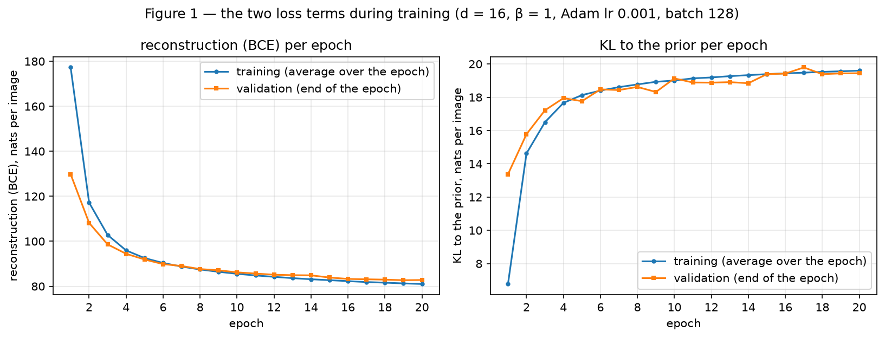
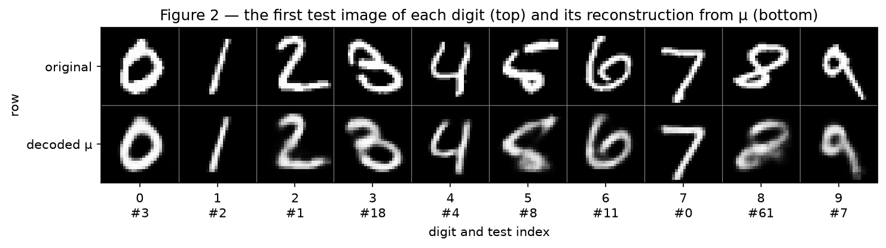
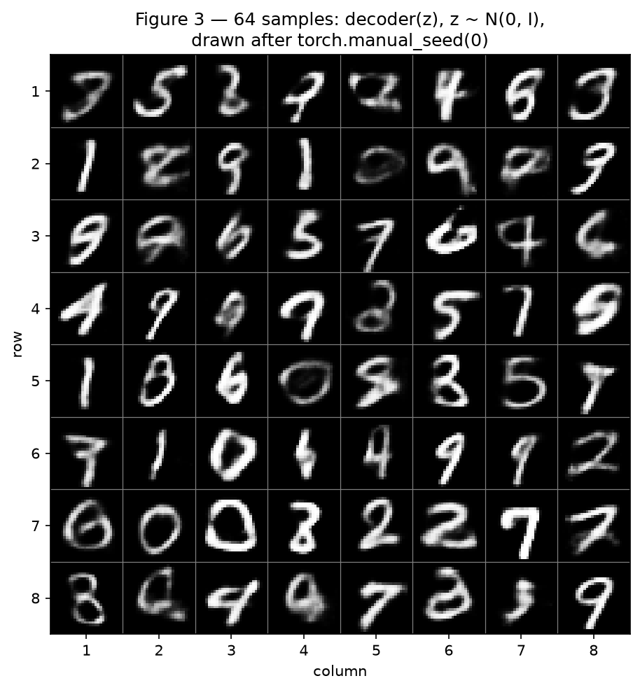
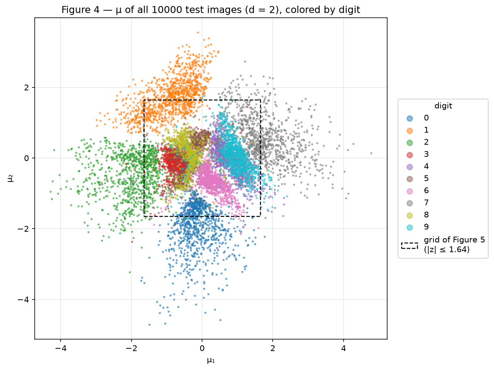
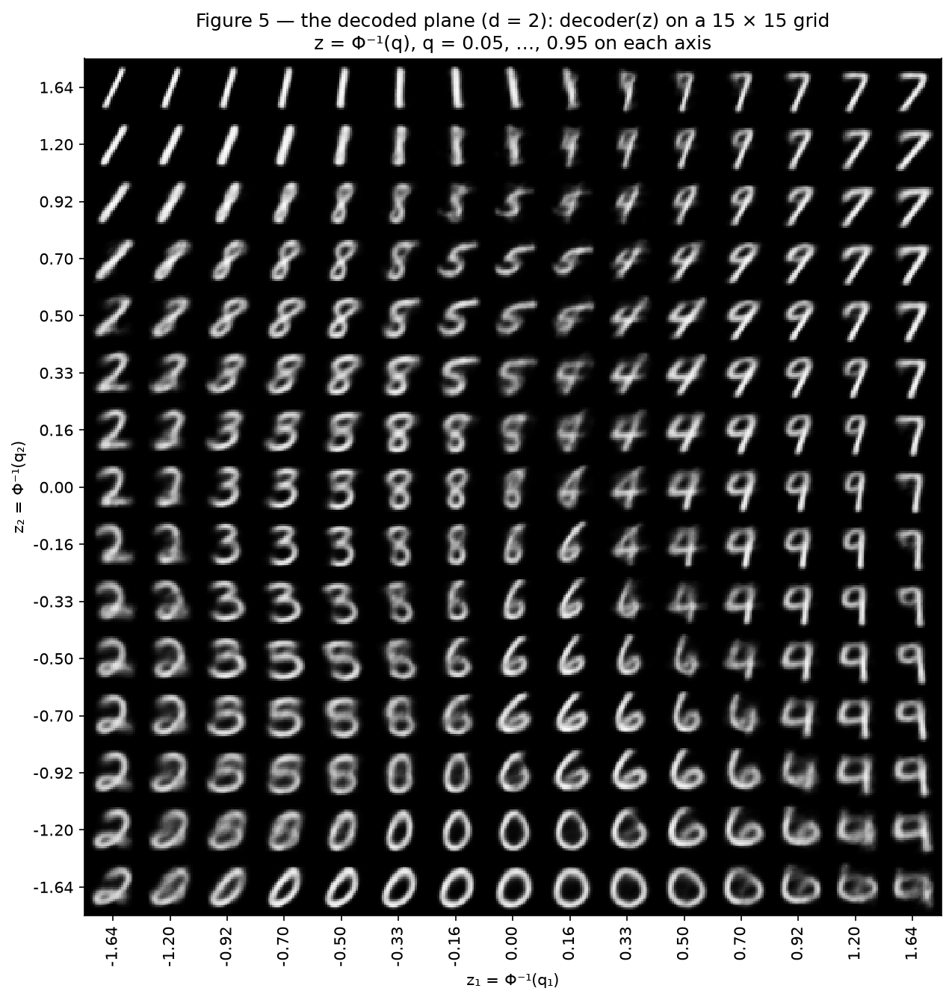
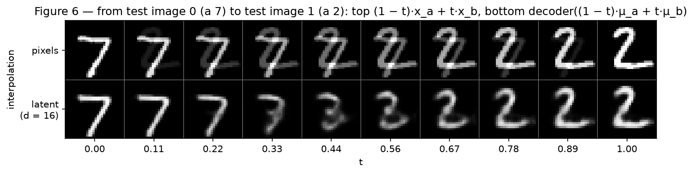

# VAE — Variational Autoencoders

A variational autoencoder trained on MNIST twice: first with a 16-dimensional latent space, logging the two terms of its loss separately, then with a 2-dimensional one that can be drawn, to see what the prior buys and what it costs. The model is built and trained with PyTorch and autograd, as the statement allows; every VAE-specific part is written out in `code/vae.py`: the reparameterization, the reconstruction term (the binary cross-entropy summed over the 784 pixels), the closed-form KL to the prior, and the sampling. torchvision only loads MNIST, and SciPy only supplies Φ⁻¹ and Φ (`scipy.stats.norm.ppf` and `norm.cdf`). Both loss terms are reported in nats per image: summed over the pixels (or the latent dimensions), averaged over the images.

**Approach.** The code is split into files under `code/`: `vae.py` (the model, the reparameterization, both loss terms, the sampling and the training loop), `common.py` (settings, the MNIST split and plotting helpers), `exercise1.py` and `exercise2.py` (the experiments, the figures and the measurements behind each analysis), `loss_check.py` (checks of the hand-written terms against independent computations) and `main.py`, which runs everything and writes `results/results.json`; `check_report.py` then confirms that the numbers of this report match that file. Every number and figure in this report is reproduced by installing `requirements.txt` and running, from the repository root:

```
python docs/exercises/vae/code/main.py
python docs/exercises/vae/code/check_report.py
```

The first run downloads MNIST into `data/MNIST` (not committed). The whole script takes about 90 seconds on a laptop CPU. The results below were produced with torch 2.15.0 and torchvision 0.29.2, the versions `requirements.txt` pins, on an Apple M2 Max CPU, where two runs give identical numbers, bit for bit. PyTorch's floating-point arithmetic can differ in the last bits on other processors, and training can amplify such differences, so on other hardware the numbers may move slightly.

**Seeds.** `torch.manual_seed(42)` is called right before building each of the two models, so both start from the same seed; the mini-batch shuffling and the ε of training come from that same generator. The split uses `torch.Generator().manual_seed(42)`, exactly as given, and the prior samples of Figure 3 are drawn after `torch.manual_seed(0)`. Evaluation draws its ε from generators of its own (seed 1 for the validation set, seed 2 for the test set, seed 3 for the training set once training is over), so measuring a model never changes its training, and every epoch is evaluated on the validation set with the same ε. Figure 4 draws its points in a fixed random order, from a generator with seed 0.

**Training.** Both models use the recipe of the statement: Adam with learning rate 10⁻³, batches of 128, 20 epochs, β = 1. After each epoch both terms are logged on the training set (the average over the epoch's batches) and on the validation set (measured at the end of the epoch). No decision is taken during training: the budget is fixed by the statement, with no early stopping and no model selection, so the validation set is only monitored. The test set is used only once training is over: for the final numbers, for the figures the statement draws from it and for the measurements behind the analyses, none of which feeds back into training. Totals, sums and differences are computed from the unrounded values, so they can differ by 0.01 from the rounded numbers they combine.

**Challenges.**

- *Hand-written terms that can be trusted.* `loss_check.py` compares each term with an independent computation. The reconstruction term equals `F.binary_cross_entropy(..., reduction="sum")` divided by the batch size, the call the statement names, to a relative 9.2 × 10⁻⁸ on all 10 000 validation images; its gradient agrees to 7.7 × 10⁻⁸ wherever the built-in function does not floor \(\hat{x}(1 - \hat{x})\) at 10⁻¹² in its backward pass, which happens on 3.49% of the pixels, all but 1 of them background pixels. Where the sigmoid saturates at exactly 0 or 1, both floor the log at −100 and give the same value and the same gradient at the logits, exactly zero. The closed-form KL matches a Monte Carlo estimate with 200 000 samples on 5 validation images: the largest of the five gaps is 2.04 standard errors (0.06%); and the reparameterization passes the gradients ∂z/∂μ = 1 and ∂z/∂log σ² = σε/2 exactly.
- *The reduction of the reconstruction term.* Summing over the pixels and averaging over the images keeps both terms in nats per image, so that β = 1 weighs them as the ELBO does. `reduction="mean"` would divide the reconstruction term by 784.00 (checked in `loss_check.py`), the same as training with β ≈ 784.
- *An answer to every analysis question, with a number.* Each answer in items 1E and 2E is backed by measurements printed by the code: the density of the cloud of training codes at the samples of Figure 3 and the digits around them, the share of grey pixels among the ink, the information a KL can hold, the spread of the reconstructions, the ink of each interpolated image. What an image looks like is a reading of the figure, and the text points to the cells it describes.

``` python title="code/main.py"
--8<-- "docs/exercises/vae/code/main.py"
```

## Exercise 1

*A VAE on MNIST.*

### A — Load and split the data

MNIST is loaded with `torchvision.datasets.MNIST(..., download=True, transform=transforms.ToTensor())`, which puts the pixels in [0, 1] (the range of the training images is [0.0, 1.0]), and each 28 × 28 image is flattened into a 784-vector. The 60 000 training images are split with `random_split(train_full, [50_000, 10_000], generator=torch.Generator().manual_seed(42))`, exactly as in the statement: 50 000 images for training and 10 000 for validation. The 10 000 official test images are the test set. The only change to the statement's lines is the root folder: `data/` at the repository root, written as an absolute path so the script runs from any directory (`load_mnist` in `code/common.py`).

### B — Build the model

| Part | Layers |
|---|---|
| Encoder | 784 → 512 → 256, ReLU after each |
| Heads | two linear layers 256 → d: one for μ, one for log σ² |
| Decoder | d → 256 → 512 → 784, ReLU after the hidden layers, sigmoid at the output |

With d = 16 the model has 1 079 600 parameters. The loss of one image, minimized on the average over the batch, is the negative ELBO, its reconstruction term estimated with one sample of z per image:

$$
L = \underbrace{-\sum_{j=1}^{784} \Big[x_j \log \hat{x}_j + (1 - x_j) \log (1 - \hat{x}_j)\Big]}_{\text{reconstruction (BCE)}} \;+\; \beta \cdot \underbrace{\tfrac{1}{2}\sum_{i=1}^{d} \left(\mu_i^2 + \sigma_i^2 - 1 - \log \sigma_i^2\right)}_{\text{KL}}, \qquad \beta = 1 .
$$

The four VAE-specific parts are the functions of `code/vae.py`, all written out:

- `reparameterize`: z = μ + σ ⊙ ε with σ = exp(½ log σ²) and ε ~ N(0, I). The noise enters as an input, so the gradient of the reconstruction reaches both heads.
- `reconstruction_term`: −log p(x | z) for a decoder that outputs, per pixel, the probability \(\hat{x}_j\) that it is "on" (a Bernoulli likelihood). It is the formula above, summed over the 784 pixels and averaged over the images. As in `F.binary_cross_entropy`, each log is floored at −100, so a pixel whose output is saturated at exactly 0 or 1 costs at most 100 nats when its target disagrees, rather than an infinite loss, and `torch.where` keeps the unused log away from −∞ so that the gradient there stays finite.
- `kl_term`: the KL from N(μ, σ²) to N(0, I) in closed form, summed over the d dimensions and averaged over the images; `torch.distributions` is not used anywhere.
- `sample`: decodes z ~ N(0, I).

``` python title="code/vae.py"
--8<-- "docs/exercises/vae/code/vae.py"
```

### C — Train

The untrained model has a validation reconstruction of 544.72 nats and a KL of 0.0291 nats. Both terms, logged after each epoch (selected epochs; all 20 are in Figure 1 and in `results/results.json`):

| Epoch | Training reconstruction | Training KL | Validation reconstruction | Validation KL | Validation total |
|---|---|---|---|---|---|
| 1 | 177.28 | 6.78 | 129.82 | 13.37 | 143.19 |
| 2 | 117.18 | 14.62 | 108.16 | 15.78 | 123.93 |
| 5 | 92.54 | 18.13 | 91.90 | 17.76 | 109.67 |
| 10 | 85.54 | 19.01 | 86.19 | 19.13 | 105.33 |
| 15 | 82.72 | 19.39 | 83.89 | 19.39 | 103.29 |
| 20 | 81.03 | 19.60 | 82.79 | 19.44 | 102.24 |

On the test set, after training:

| d = 16, test set | nats per image |
|---|---|
| Reconstruction | **82.30** |
| KL | **19.48** |
| Negative ELBO (their sum) | **101.78** |

The statement's reference values are about 81 and 20. The reconstruction term cannot reach zero: for a grey pixel the BCE is smallest at \(\hat{x}_j = x_j\), where it equals the pixel's entropy, so even a perfect decoder would pay 45.53 nats per test image (the summed pixel entropies). The 82.30 nats are 36.77 above that floor.


/// caption
Figure 1 — The reconstruction term (left) and the KL term (right) per epoch, on the training set (average over the epoch) and on the validation set (end of the epoch), d = 16.
///

In epoch 1 the training average is far above the validation value (177.28 against 129.82) because it averages over the whole epoch, starting from the untrained model, while the validation is measured after the epoch. From epoch 4 on, the training average and the validation value differ by at most 1.77 nats in reconstruction and 0.61 nats in KL. Measured the same way once training is over, the reconstruction is 80.80 nats on the training set and 82.79 on the validation set, a gap of 1.99 nats, and the KL on the training set is 19.51 nats (the 19.60 of the table is the average over the batches of epoch 20, while the weights were still changing).

### D — Reconstructions and samples

Figure 2 uses the first test image of each digit, at test indices 3, 2, 1, 18, 4, 8, 11, 0, 61 and 7 (digits 0 to 9), and reconstructs each by decoding μ, without sampling z. Figure 3 decodes 64 codes z ~ N(0, I) drawn after `torch.manual_seed(0)`. Both figures show the decoder's output \(\hat{x}\), the probability of each pixel.


/// caption
Figure 2 — Top: the first test image of each digit (test index below the digit). Bottom: its reconstruction, the decoder applied to μ.
///


/// caption
Figure 3 — 64 images decoded from z ~ N(0, I), drawn after `torch.manual_seed(0)`, in an 8 × 8 grid.
///

### E — Analysis

**Why the optimizer pays more KL.** The KL is the price of a code that says something about the image. Averaged over the data it splits into the information the code carries about x and the mismatch between the cloud of all codes and the prior (the latent-space lecture's split, with q(z) the aggregate posterior):

$$
\mathrm{E}_x\big[\mathrm{KL}(q(z \mid x)\,\|\,p(z))\big] = I_q(x; z) + \mathrm{KL}(q(z)\,\|\,p(z)) .
$$

The untrained encoder returns almost the prior for every image (KL 0.0291 nats), a code that tells the decoder almost nothing about which image it came from. If the code carries no information about the image, the decoder's output cannot depend on the image, and no such output beats the best single image for the test set, the mean test image, which costs 205.65 nats of reconstruction. The optimizer minimizes the sum of the two terms, so it accepts a larger KL as long as what the code tells the decoder lowers the reconstruction by more: the trained model pays 19.48 nats of KL on the test set and reconstructs at 82.30, a total of 101.78, against at least 205.65 for any model whose code says nothing. The logged terms show the trade. In epoch 1 the validation KL jumps from 0.0291 to 13.37 nats while the reconstruction falls from 544.72 to 129.82 (part of that fall is the decoder learning to draw digits at all). From epoch 1 to epoch 20 the KL rises another 6.07 nats (13.37 to 19.44) while the reconstruction falls 47.03 more (129.82 to 82.79), and the total falls by 40.95. The KL is paid only where it helps: on the test set, 11 of the 16 dimensions cost between 1.195 and 2.449 nats each, with a mean σ between 0.09 and 0.32, while the other 5 stay on the prior, with at most 0.0016 nats and a mean σ between 0.98 and 1.00. A dimension costs KL as soon as it carries anything, and the optimizer leaves these 5 unused.

**Why Figure 3 looks worse than Figure 2: two reasons.**

*Reason 1: where the prior samples land.* The decoder is trained only on codes drawn from q(z | x) for training images, and the KL pulls each of those Gaussians toward N(0, I) without making the cloud they form together equal to N(0, I). That mismatch is the second term of the split above, and it is far from zero: with 50 000 training images the code can carry at most log 50 000 = 10.82 nats about which image it came from, so of the mean training KL of 19.51 nats at least 8.69 nats are KL(q(z) ‖ p(z)). Two measurements show where the 64 codes of Figure 3 land in that cloud (cells given as row, column):

- *In thin regions.* At the codes of the test images, the density of the cloud of training codes has a median log q(z) of −31.28 and a 1st percentile of −73.02. At the codes of Figure 3 the median is −51.32, 20.04 nats lower, and 10 of the 64 codes fall below that 1st percentile, where 1% of 64 would be 0.64. Few training codes lie near them, and most of them decode to unusual styles: very thick strokes, as at (3, 6), (7, 3) and (7, 4), or malformed digits, as at (4, 1) and (4, 8).
- *Between digits.* For 21 of the 64 codes, no digit has a majority among the 10 nearest training codes, against 3.56% of the test codes. These codes fall between the clusters of different digits, where the nearby training codes belong to several digits. Five of the shapes that are no clear digit, at (1, 5), (2, 7), (3, 2), (5, 5) and (8, 4), are among them; two others, at (2, 2) and (8, 2), are not.

*Reason 2: what the decoder outputs for a given z.* The decoder does not output an image but the probability of each pixel, the mean of p(x | z). Under the BCE, as under the squared error of the lecture's section on blur, the loss-minimizing output for a code is the average of the images compatible with it; and maximizing a likelihood minimizes the forward KL, which is mode-covering: when the model cannot pick one image, it hedges between them. So even at the codes of real images the output is blurred, and the more the images compatible with a code differ, the more their average is blurred. Among the pixels with ink (above 0.1), the share that is grey (below 0.9), a measure that does not depend on how much ink an image has, is 48.92% in the test images, 72.86% in their reconstructions from μ and 81.25% in the samples of Figure 3, the blurriest of the three.

**Why μ in Figure 2.** μ is the mean and the mode of q(z | x), the encoder's most likely code for the image. A sampled z = μ + σε moves the code by the encoder's uncertainty, a mean σ between 0.09 and 0.32 on the active dimensions. The reconstruction would then change from one draw to the next and show that noise on top of what the code keeps. Decoding μ shows the code itself, the same image every time, and it is also the better reconstruction: 77.02 nats on the test set against 82.30 with a sampled z.

### Code

``` python title="code/exercise1.py"
--8<-- "docs/exercises/vae/code/exercise1.py"
```

``` python title="code/common.py"
--8<-- "docs/exercises/vae/code/common.py"
```

``` python title="code/loss_check.py"
--8<-- "docs/exercises/vae/code/loss_check.py"
```

## Exercise 2

*A latent space you can see.*

### A — Train a 2-D VAE

The model, data, seed, β and training budget are those of Exercise 1; only d changes, from 16 to 2 (`torch.manual_seed(42)` and then `VAE(2)`). After epoch 20 its validation reconstruction is 134.58 nats and its KL 6.76 nats. On the test set, next to the d = 16 model:

| Model | Test reconstruction | Test KL | Negative ELBO |
|---|---|---|---|
| d = 16 (Exercise 1) | 82.30 | 19.48 | 101.78 |
| d = 2 | **133.88** | **6.78** | 140.66 |

The statement expects roughly 135 and 7 nats. With two dimensions the reconstruction is 51.58 nats worse and the KL 12.70 nats smaller.

### B — The encoded test set


/// caption
Figure 4 — μ of all 10 000 test images under the d = 2 model, colored by digit. The dashed square is the region decoded in Figure 5 (|z| ≤ 1.64 on both axes).
///

### C — The decoded plane

Figure 5 decodes a 15 × 15 grid of z = (z₁, z₂) with each coordinate z = Φ⁻¹(q), for the 15 evenly spaced q from 0.05 to 0.95. The grid values run from −1.64 to 1.64, close together near 0 and far apart toward the edges. **Because the prior N(0, I) is the product of two independent N(0, 1) and Φ is their CDF, evenly spaced q are evenly spaced in prior probability: each tile stands for a slice of width 0.0643 in q on each axis, so every tile covers the same prior mass, 0.0643² = 0.0041.** A linear grid over the same range would give the centre tile a mass of 0.00875 and a corner tile 0.00059, 14.8 times less.


/// caption
Figure 5 — The decoder of the d = 2 model on a 15 × 15 grid, z = Φ⁻¹(q) with q = 0.05, …, 0.95 on each axis, tiled in the same layout as the plane: z₁ grows to the right, z₂ upward. The tick labels give the z of each column and row.
///

### D — Interpolation

The two images are the first two of the test set, **test index 0 (a 7) and test index 1 (a 2)**, a rule fixed before looking at any interpolation. Figure 6 uses t = 0, 1/9, …, 1. The top row mixes the pixels, \((1 - t)\,x_a + t\,x_b\). The bottom row decodes \((1 - t)\,\mu_a + t\,\mu_b\) with the d = 16 model of Exercise 1, so its two ends are the reconstructions of the two images, not the images themselves.


/// caption
Figure 6 — From test image 0 (a 7) to test image 1 (a 2), for t from 0 to 1. Top: interpolation in pixel space. Bottom: interpolation in the latent space of the d = 16 model, decoded.
///

### E — Analysis

**Which digits overlap in Figure 4, and the same transition in Figure 5.** To measure the overlap, each test code is given the most common digit among its 10 nearest training codes (ties go to the smaller digit), and the test codes that land among another digit's codes are counted per pair. In both directions: 4 and 9, 641; 5 and 8, 269; 3 and 5, 228; 7 and 9, 118; 3 and 8, 108. The largest overlap is between **4 and 9**, the purple and cyan clouds right of the centre of Figure 4. Their mixed codes are centred at μ = (0.96, −0.11), and a second group of about the same size mixes 3, 5 and 8 left of the centre (269 + 228 + 108 = 605 codes over its three pairs).

The same transition is in the right half of Figure 5. The cells whose nearest training codes switch between 4 and 9 form a band from row 1, column 10 down to row 14, column 15 (rows counted from the top, columns from the left). In rows 4 to 7 the switch happens between columns 11 and 12, from z₁ = 0.50 to 0.70, and the mixed codes of Figure 4 fall around row 9, column 13. Along those rows the open 4 closes. The images in between are 4s whose two upper strokes meet in a squarish loop, which is also a 9 with an angular loop. One cell to the right the loop is round and the stem straight, and the image is a 9. Where the 4s meet the 5s and the 6s (column 9) the in-between images are faint and blurred. In the 3–5–8 group, in the centre-left, the in-between images are 8s with one side of a loop left open, which can be read as a 3 or a 5, as at (6, 3) and (6, 6).

**What two numbers per image force the model to throw away.** The d = 2 model reconstructs 51.58 nats worse because its code carries less. By the split of item 1E, the KL is an upper bound on the information the code holds: at most 6.78 nats per image, that is 9.8 bits, and naming the digit alone takes log₂ 10 = 3.3 bits. What goes is the detail of each image. The reconstructions of all test images of one digit vary only 34% as much as the images themselves (summed pixel variance 14.31 against 41.67), against 73% (30.33) with d = 16. Part of the digit's identity goes too: the most common digit among the 10 nearest training codes matches the label for 80.84% of the test images in 2-D and 96.36% in 16-D. Figure 5 is the evidence. Inside the region of Figure 5, the plane is spent on which digit it is: all ten digits get a share of the grid, between 18 and 29 of the 225 cells each by the nearest training codes. Inside a digit's region only one or two traits vary: the slant of the 1s along the top, the width and slant of the 0s along the bottom, the base of the 2s down the left edge, flat at the top and looped at the bottom. Every image in Figure 5 is a smooth, typical digit or a blend of two neighbouring ones; what two numbers cannot hold are the quirks of each handwriting, the 66% of the within-digit spread that the reconstructions lose.

**The two rows of Figure 6.** The **bottom (latent) row** passes through images that look like digits; the top (pixel) row does not.

- The pixel row is two digits at once. Between t = 0.22 and 0.56 each image has 209 to 212 ink pixels (above 0.1), close to the 222 that the 7 and the 2 cover together, while the 7 has 105, the 2 has 145 and a test image has 137.7 on average: the strokes of both digits, each at partial intensity. Digit images do not form a convex set, so the average of two digits need not be a digit, and here it is not.
- The latent row is decoded, and the decoder draws digit-like images where it was trained. The straight line from \(\mu_a\) to \(\mu_b\) stays where the codes of real images are: even the lowest of its ten points, at log q(z) = −40.25, is denser than the μ of 18.02% of the test images (their median is −26.89). The KL term makes the posteriors overlap, and the lecture credits that overlap with filling the space between training examples. Along the row the 7 bends into a 3-like shape around t = 0.33 to 0.56 (at t = 0.56 the most common digit among the 10 nearest training images is a 3) and then into the 2, one stroke at a time: the ink never covers more pixels than at the 2's end (175), against 209 to 212 in the pixel row. The middle images are the faintest, with a total intensity (the sum of the pixel values) of 47.1 at t = 0.33 against 75.1 and 110.5 at the two ends, and that is where the path's density is lowest. Like every output of the decoder, these images are blurrier than real digits.

### Code

``` python title="code/exercise2.py"
--8<-- "docs/exercises/vae/code/exercise2.py"
```

``` python title="code/check_report.py"
--8<-- "docs/exercises/vae/code/check_report.py"
```

## Results summary

| # | Quantity | Value |
|---|---|---|
| 1 | Ex. 1 — test reconstruction, KL and negative ELBO (d = 16) | reconstruction 82.30, KL 19.48, negative ELBO 101.78 nats per image |
| 2 | Ex. 1 — validation KL at the first and at the last epoch | 13.37 nats after epoch 1, 19.44 nats after epoch 20 |
| 3 | Ex. 2 — test reconstruction and KL (d = 2) | reconstruction 133.88, KL 6.78 nats per image |
| 4 | Ex. 2 — the two test indices interpolated | 0 (a 7) and 1 (a 2) |
