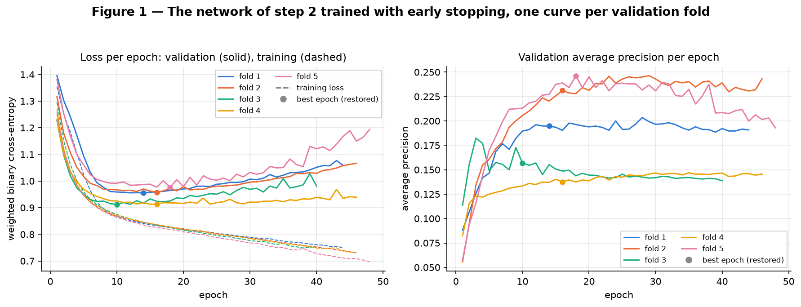
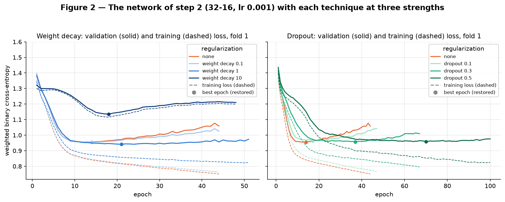
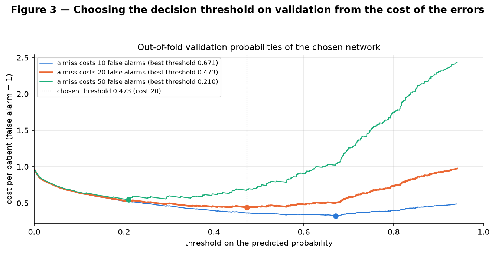
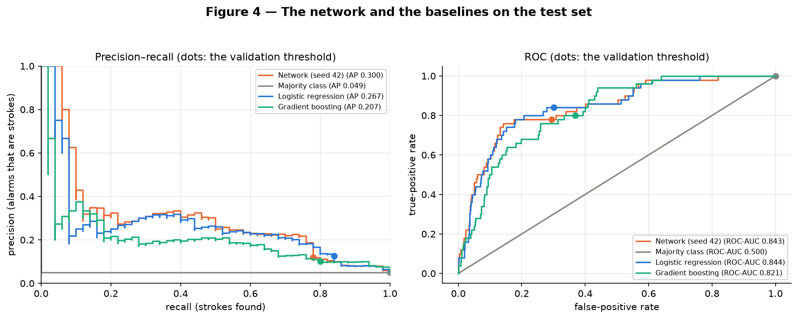
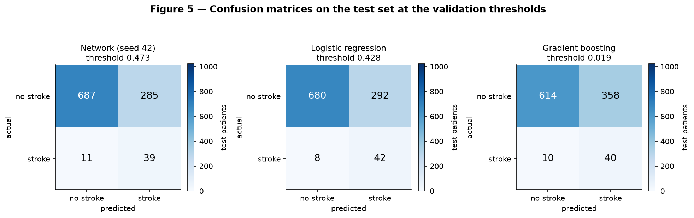
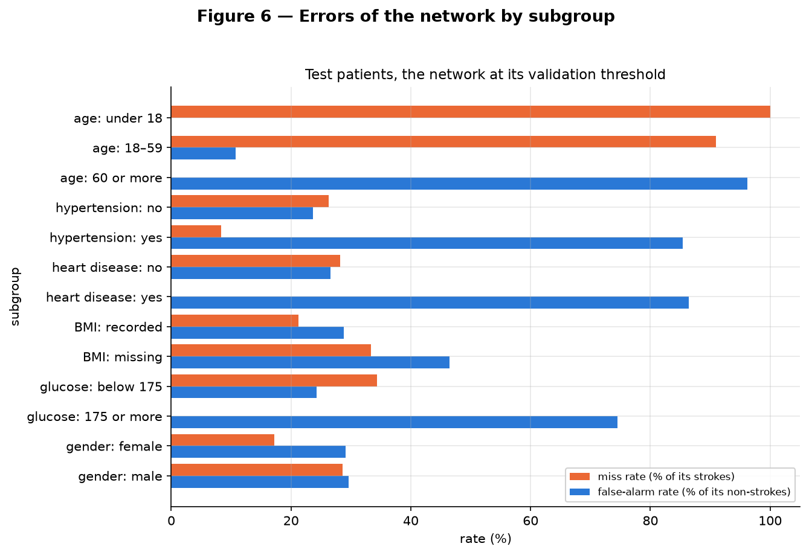
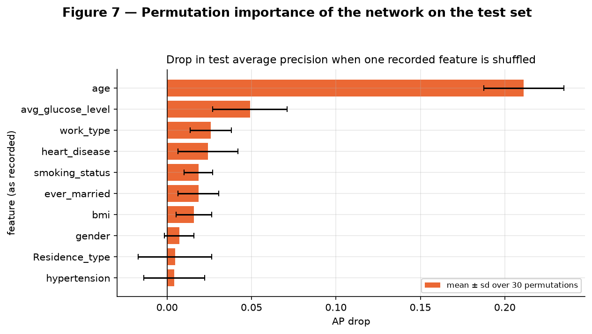

# Classification — Stroke Prediction

**Gabriel Fernando Missaka Mendes · Eduardo Takei Yaginuma · Luca Santana Feltrin** — Insper, Artificial Neural Networks and Deep Learning, 2026.2

This report trains a neural network on the dataset of our [EDA](../eda/index.md) — same task, same split, same preprocessing pipeline — and asks the two questions of this delivery: does the network learn something simpler models do not, and how far can the number it reports be trusted? The short answers: on the test set it matches logistic regression rather than beating it, and its test average precision, measured on 50 strokes, is uncertain to within about ±0.1.

**Approach.** The code is split into files under `code/`: `common.py` (the settings fixed in step 0, the EDA's data and pipeline, the validation folds and the report helpers), `starting_point.py` (step 0), `baselines.py` (step 1), `network.py` (the network and its training loop), `validation.py` (the cross-validation shared by every model), `search.py` (steps 2–4), `evaluate.py` (step 5), `errors.py` (step 6), `main.py`, which runs the steps in order, and `check_report.py`, which confirms that the step headings, every table with its title, the key numbers of the text and every row of the results summary are exactly what the scripts produced, and that every figure is committed, shown once and followed by its conclusion. Every table, number and figure in this report is reproduced by installing `requirements.txt` and running, from the repository root:

```
python docs/projects/classification/code/main.py
python docs/projects/classification/code/check_report.py
```

The run takes about four minutes on a laptop CPU. It writes Figures 1–7 to `figures/` and, under `results/`, every table as `tableNN.csv` (NN is the table's number in this report) and in Markdown, and the numbers quoted in the text as JSON. The data, the split and the pipeline come from the EDA's `code/preprocessing.py`, unchanged except that step 0 removes the pipeline's BMI-missing indicator, and the split is checked row by row against the one the EDA saved. The results were produced with torch 2.15.0 and scikit-learn 1.9.0 on an Apple M2 Max CPU, where repeated runs give identical numbers; a clean clone in a fresh virtual environment (torch 2.15.0, scikit-learn 1.9.1) reproduced every table and number byte for byte.

**Seeds.** `SEED = 42`, the EDA's constant, fixes the split, the validation folds and gradient boosting (`random_state=42`). Every network calls `torch.manual_seed(seed)` before it is built, which fixes its initial weights and its dropout masks, and draws its mini-batches with a `torch.Generator` of the same seed: 42 throughout validation, 42 to 46 for the five final retrainings of step 5. The bootstrap and the permutations use `np.random.default_rng(42)`; logistic regression has no randomness.

**Rule followed throughout.** Steps 0 to 4 use only the 4,088 training rows: every choice — the pipeline, the configuration, the number of epochs, each model's decision threshold — is made on 5 validation folds carved out of them, with the pipeline refitted inside every fold. The 1,022 test rows are read once, in step 5, after all of that was fixed; step 6 analyzes the seed-42 network on those same test rows and changes nothing. Only steps 5 and 6 (`evaluate.py` and `errors.py`) receive the test rows. The scripts were run several times while this report was written; none of the choices above changed after the test set was first read, and every run gives the same numbers.

**Challenges.**

- *Few positives.* The training set holds 199 strokes, so each validation fold holds 39 or 40, and the validation AP of every learned model has a fold-to-fold standard deviation of 0.02 to 0.06. The report gives each one as a mean with its standard deviation and chooses among configurations with the one-standard-error rule rather than the highest mean.
- *A feature that may describe the label.* The EDA found BMI missing about five times more often among the strokes, without knowing whether BMI is recorded before the event. Its plan said to prefer the model without the missingness indicator if the indicator carried the gain. The gain it shows is smaller than the fold-to-fold standard deviation, but nothing says when BMI is recorded, so step 0 takes the conservative reading and removes it, for every model.
- *A weighted loss and a threshold.* Weighting the positives in the loss distorts the probabilities, so the decision threshold is chosen on validation from the cost of the errors fixed in step 0, not read off as 0.5.
- *A test set with 50 strokes.* One test number says little on its own: step 5 adds five retrainings with different seeds and a paired bootstrap of the test rows.

``` python title="code/main.py"
--8<-- "docs/projects/classification/code/main.py"
```

## 0. Starting point

**Main metric and success criterion, fixed before any model was trained** (constants `MAIN_METRIC`, `CRITERION_GAIN` and `COST_MISS` in `code/common.py`). The three points below were committed word for word in [66f89ca](https://github.com/gabrielfmendesm/ann-dl/commit/66f89ca9f2d4a26b83f00f238c05d9c76dad7fdd), before the first training run:

- **Main metric: average precision** (AP, the area under the precision–recall curve). Only 4.87% of the rows are positive, so accuracy rewards a model that never predicts a stroke, and ROC-AUC hides false alarms behind the large number of true negatives; AP is read against the 4.87% that a random ranking scores.
- **Success criterion: the network's mean test AP over 5 seeds is at least 15% higher than the test AP of the best baseline** (the baseline with the highest validation AP), **and the gap is larger than the network's standard deviation across the 5 seeds.**
- **Cost of the errors, for the decision threshold: a missed stroke costs as much as 20 false alarms.** A false alarm sends a patient to a follow-up consultation; a missed stroke withholds preventive care from someone who will have one.

**The pipeline.** `load_raw()`, `split()` and `build_preprocessor()` are imported from the EDA's `code/preprocessing.py`: the same stratified 80/20 split with `random_state=42` (4,088 training rows with 199 strokes, 1,022 test rows with 50) and the same `ColumnTransformer` — median imputation, `log1p` and standardization for glucose and BMI, standardization for age, full one-hot encoding of the seven categorical features. It is never fitted on more than the rows a model trains on: inside each validation fold on that fold's training part, and for the final models on the 4,088 training rows. The validation folds are `StratifiedKFold(n_splits=5, shuffle=True, random_state=42)` on the training rows, as the EDA planned: 817 or 818 rows each, with 39 or 40 strokes.

**The EDA's grading and its own plan.** The EDA has not been graded yet, so there are no grading corrections to apply. Its synthesis (section 5) listed what this delivery should do, and this report follows that list: average precision next to the prevalence; the threshold chosen on validation; `pos_weight` ≈ 19.5 computed inside the training folds; cross-validation with the pipeline refitted in each fold; recall per age band (step 6, through its complement, the miss rate); the sensitivity check on the two adult BMIs below 12 (step 4); and the BMI-missing indicator trained with and without, below. Only the optional glucose second-mode flag is left out: step 6 uses it as a subgroup rather than as a feature.

**Table 1 — Validation AP with and without the BMI-missing indicator (5 folds: mean and sample sd).** The network is the one of step 2.

| model | AP with the indicator | sd (with) | AP without it | sd (without) | gain from the indicator |
|---|---|---|---|---|---|
| Logistic regression | 0.2200 | 0.0434 | 0.1891 | 0.0410 | 0.0308 |
| Gradient boosting | 0.1948 | 0.0317 | 0.1966 | 0.0441 | −0.0017 |
| Network (step 2) | 0.2180 | 0.0578 | 0.1933 | 0.0465 | 0.0247 |

The indicator raises the mean validation AP of logistic regression by 0.0308 and of the network by 0.0247; gradient boosting does not gain from it (−0.0017). Both gains are smaller than the fold-to-fold standard deviations (0.0410 to 0.0578). The EDA's rule was: *If the indicator carries the gain, treat it as a collection artifact and prefer the model without it, unless BMI is known to be recorded before the prediction.* Nothing in the dataset says when BMI is recorded, so we take the conservative reading: any gain makes the indicator suspect. The network, the model this delivery is about, gains from it (and so does logistic regression), so **the indicator is removed, for every model**, to keep the comparison between them on one pipeline (`missing="drop"` in the `ColumnTransformer`; the rest of the EDA's pipeline is untouched). Logistic regression and the network give up some validation AP for not relying on a feature that may only describe how the stroke patients were recorded. The removal also decides which baseline is best on validation: with the indicator it would have been logistic regression (0.2200), without it gradient boosting (Table 2), the baseline the criterion of step 0 is measured against. The pipeline now outputs 23 columns; in fold 1 it outputs 22, because the training set's only `gender = Other` row falls in that fold's validation part, so its encoder never sees that category.

### Code

``` python title="code/common.py"
--8<-- "docs/projects/classification/code/common.py"
```

``` python title="code/starting_point.py"
--8<-- "docs/projects/classification/code/starting_point.py"
```

## 1. Baselines

The three baselines are fitted on the same fold matrices as the network: the trivial `DummyClassifier(strategy="most_frequent")`, the linear `LogisticRegression(class_weight="balanced")` and, as the optional one, `HistGradientBoostingClassifier(class_weight="balanced")`. The two learned ones weight the classes in the same ratio as the network's `pos_weight`.

**Table 2 — The baselines on the 5 validation folds (mean and sample standard deviation across folds).**

| model | AP (mean) | AP (sd) | ROC-AUC (mean) | ROC-AUC (sd) |
|---|---|---|---|---|
| Majority class | 0.0487 | 0.0005 | 0.5000 | 0.0000 |
| Logistic regression | 0.1891 | 0.0410 | 0.8381 | 0.0120 |
| Gradient boosting | 0.1966 | 0.0441 | 0.8267 | 0.0195 |

- **The trivial baseline scores the prevalence.** It gives every patient the same score, so its AP is the share of strokes, 0.0487, and its ROC-AUC is 0.5: this is the floor any model must clear.
- **Both learned baselines reach about four times the floor**: logistic regression 0.1891 and gradient boosting 0.1966. Their ROC-AUCs, 0.8381 and 0.8267, are close to the 0.834 that age alone reaches in the EDA (Table 10 of the EDA), which suggests that most of their ranking comes from age (step 6 confirms it for the network).
- **Gradient boosting is the best baseline on validation**, the one the criterion of step 0 refers to. It leads logistic regression by 0.0075, less than a fifth of either model's fold-to-fold standard deviation (0.0410 and 0.0441), so the two are tied in practice.

### Code

``` python title="code/validation.py"
--8<-- "docs/projects/classification/code/validation.py"
```

``` python title="code/baselines.py"
--8<-- "docs/projects/classification/code/baselines.py"
```

## 2. The network

**Table 3 — The network of step 2, layer by layer (23 inputs).**

| layer | shape | activation | initialization | parameters |
|---|---|---|---|---|
| hidden 1 | 23 → 32 | ReLU | He (Kaiming) normal | 768 |
| hidden 2 | 32 → 16 | ReLU | He (Kaiming) normal | 528 |
| output | 16 → 1 | none (logit) | Glorot (Xavier) normal | 17 |

- **Input and output.** 23 inputs, the columns of the pipeline, and **one output unit that returns a logit**. The loss is `BCEWithLogitsLoss`, which applies the sigmoid itself in a numerically stable form; the model's probability of a stroke, the sigmoid of the logit, is computed only to make predictions (it is not a calibrated risk: see the limitations in step 7). `pos_weight` is the ratio of negatives to positives in the rows the network trains on (19.44 to 19.57 across the folds, 19.54 on the full training set), so the strokes, as a group, weigh as much in the loss as the non-strokes (199 against 3,889 in the full training set).
- **Layers and widths.** Two hidden layers of 32 and 16 units, enough to combine features (age with hypertension, glucose with age) that a linear model can only add. They give **1,313 parameters for 4,088 training rows** (3,270 or 3,271 in each fold): fewer parameters than rows, but many more than the 199 positives that carry the signal, which is why steps 3 and 4 watch for overfitting. The widths are a starting point, not a tuned choice: 32 units, slightly more than the 23 inputs, let the first layer form combinations without compressing them first; 16 units halve that on the way to the single output; and step 4 tries a narrower network (16) and a wider one (64-32) around it.
- **Activation and initialization.** ReLU after each hidden layer. Hidden weights start from He (Kaiming) normal, the variance that keeps ReLU activations from shrinking or growing from layer to layer; the output layer, which has no ReLU after it, from Glorot (Xavier) normal. Biases start at 0: with `pos_weight` the two classes weigh the same, so a logit near 0 — even odds — is the right place to start, and the random output weights only scatter the first logits around it.

### Code

``` python title="code/network.py"
--8<-- "docs/projects/classification/code/network.py"
```

## 3. Training

- **Optimizer: AdamW with weight decay 0 for the network of step 2** — exactly Adam, the course's default for an MLP on tabular data; the weight decay is a hyperparameter of step 4. Adam adapts the step size of each parameter, which suits inputs as different as standardized ages and one-hot flags.
- **Learning rate 10⁻³**, the course's starting point for Adam; step 4 also tries 3 × 10⁻³.
- **Batches of 128 rows**: at a 4.87% prevalence a batch holds about 6 strokes on average, and a batch with none at all comes up with probability about 0.17%, so the positive term of the loss is present in almost every step.
- **Up to 300 epochs with early stopping on the validation loss**: after each epoch the weighted loss is computed on the fold's validation part, the weights of the lowest validation loss are kept in memory, training stops after 30 epochs without improvement, and the best weights are restored. The patience is long because the validation loss of a fold with 39 or 40 strokes moves from epoch to epoch (Figure 1): a short one would stop on a random bump, while 30 more epochs cost a fraction of a second each and the restored weights make them harmless. The network of step 2 stops between epochs 40 and 48, far below the cap of 300. The training and validation losses are both measured after each epoch with dropout off, so the two curves are comparable.

**Table 4 — Early stopping of the network of step 2 on each fold (losses and AP at the restored epoch).**

| fold | validation positives | epochs run | best epoch | training loss | validation loss | validation AP |
|---|---|---|---|---|---|---|
| 1 | 40 | 44 | 14 | 0.8408 | 0.9554 | 0.1947 |
| 2 | 40 | 46 | 16 | 0.8359 | 0.9578 | 0.2312 |
| 3 | 40 | 40 | 10 | 0.8744 | 0.9121 | 0.1569 |
| 4 | 39 | 46 | 16 | 0.8371 | 0.9129 | 0.1375 |
| 5 | 40 | 48 | 18 | 0.8177 | 0.9767 | 0.2460 |


/// caption
Figure 1 — The network of step 2 on each validation fold: training (dashed) and validation (solid) loss per epoch (left), and validation average precision per epoch (right); dots mark the restored epoch.
///

**Conclusion — Figure 1.** Training converges in every fold: the training loss falls smoothly, without divergence or oscillation, and keeps falling to the last epoch (to between 0.6968 and 0.7498) — the network could keep fitting its 3,270 or 3,271 training rows. The validation loss falls with it for the first 10 to 18 epochs, reaches its minimum there and then rises — fold 5 goes from 0.9767 at its best epoch, 18, to 1.1940 at epoch 48. That turning point is where overfitting starts, and early stopping restores the weights from it. The validation AP (right) does not turn as clearly. In folds 1, 2 and 4 it is still creeping up after the restored epoch (to 0.2035, 0.2464 and 0.1469 at epochs 28, 29 and 35, against 0.1947, 0.2312 and 0.1375 at the restored ones); in fold 3 it peaks earlier, at epoch 3 (0.1823 against 0.1569); only in fold 5 do both peak at the same epoch. *A likely reading:* after the loss minimum the network keeps ordering the patients about as well but grows more confident, which the loss punishes and AP does not see — what the course calls a calibration problem, not a ranking one. Stopping on the loss, as the statement's skeleton does, gives up 0.009 to 0.025 of validation AP in four folds (against each run's best epoch for AP, itself an optimistic yardstick) — at most about half a fold-to-fold standard deviation — and keeps the less overconfident model. The spread between folds is large — validation AP from 0.1375 to 0.2460 at the restored epochs — because each fold holds only 39 or 40 strokes.

### Code

The training loop is `train()` in `code/network.py`, listed in step 2; the curves of Figures 1 and 2 are drawn by `code/search.py`, listed in step 4.

## 4. Regularization and hyperparameters

**Two techniques against none, each at three strengths.** Weight decay (decoupled, AdamW) at λ = 0.1, 1 and 10, and dropout after each hidden ReLU at p = 0.1, 0.3 and 0.5, are compared with the plain network on the same folds and seed; an eighth variant combines the middle strengths. The decay applies to the weight matrices only: the course recommends leaving the biases out, since they shift the activations rather than scale them. The dropout rates run from just below the course's range for fully connected layers (p = 0.2–0.5) to its top. The decay strengths start at the top of the course's 0.01–0.1 range for AdamW, given for Transformers, which train for far more steps, and go beyond it: AdamW multiplies the weights by (1 − lr × λ) at every step, and with lr 10⁻³ and the weights restored after a few hundred steps, λ = 0.1 leaves them almost untouched (last column of Table 5).

**Table 5 — The network of step 2 (32-16, lr 0.001) with each regularization (5 validation folds; the loss gap is at the restored epoch).** The last column is (1 − lr × λ) raised to the number of steps up to the median restored epoch, at 26 mini-batches per epoch.

| regularization | AP (mean) | AP (sd) | ROC-AUC (mean) | best epoch (median) | validation − training loss | weights kept by the decay |
|---|---|---|---|---|---|---|
| none | 0.1933 | 0.0465 | 0.8291 | 16 | 0.1018 | 1.0000 |
| weight decay 0.1 | 0.1951 | 0.0416 | 0.8312 | 16 | 0.1064 | 0.9593 |
| weight decay 1 | 0.2038 | 0.0417 | 0.8357 | 20 | 0.0720 | 0.5944 |
| weight decay 10 | 0.1814 | 0.0380 | 0.8235 | 25 | 0.0062 | 0.0015 |
| dropout 0.1 | 0.1957 | 0.0417 | 0.8292 | 17 | 0.0977 | 1.0000 |
| dropout 0.3 | 0.1693 | 0.0242 | 0.8289 | 39 | 0.1177 | 1.0000 |
| dropout 0.5 | 0.1721 | 0.0266 | 0.8319 | 70 | 0.1092 | 1.0000 |
| weight decay 1 + dropout 0.3 | 0.1899 | 0.0396 | 0.8386 | 43 | 0.0585 | 0.3268 |


/// caption
Figure 2 — Fold 1: validation (solid) and training (dashed) loss of the network of step 2 with weight decay (left) and dropout (right) at three strengths each, next to the network without regularization; dots mark the restored epoch.
///

**Conclusion — Figure 2.** **Weight decay at λ = 1 is the only variant that clearly narrows the loss gap without lowering the validation AP; dropout brings no measurable gain at any rate.**

- *Weight decay 0.1 barely acts.* By the median restored epoch the decay factor alone leaves the weights 0.9593 of their size (the gradient steps move them too), and the network is almost unchanged (validation AP 0.1951 against 0.1933).
- *Weight decay 1 regularizes.* The factor falls to 0.5944, the gap between validation and training loss at the restored epoch narrows from 0.1018 to 0.0720, and the validation AP rises to 0.2038, the best of the eight variants, although the gain over the plain network (0.0105) is smaller than the fold-to-fold standard deviation. In fold 1 (left) its validation loss barely rises after its minimum, while its training loss stays above the unregularized one.
- *Weight decay 10 is too strong.* The factor reaches 0.0015, the two losses meet at a high level (gap 0.0062) and the AP falls to 0.1814: the network underfits.
- *Dropout above 0.1 costs AP.* At 0.1 it changes little (0.1957); at 0.3 and 0.5 it slows the training (median best epochs 39 and 70, against 16) and lowers the AP (0.1693 and 0.1721) without narrowing the loss gap (0.1177 and 0.1092). In fold 1 (right), dropout 0.5 keeps the validation loss flat after its minimum and dropout 0.3 lets it rise more slowly than the plain network, but neither minimum is lower than the plain network's. *A likely reading:* the course notes that dropout is a technique for networks with capacity to spare, and with 32 and 16 units there is little redundancy for a third or a half of them to disappear at each step.
- *Both together.* Weight decay 1 with dropout 0.3 has the narrowest loss gap of the variants that do not underfit (0.0585) and the best ROC-AUC (0.8386), but its AP, 0.1899, stays below weight decay 1 alone and below the plain network (0.1933).

**The search.** 48 configurations — two learning rates (10⁻³, 3 × 10⁻³) × three architectures (16, 32-16, 64-32) × the eight regularization variants — each trained with early stopping on the 5 folds:

**Table 6 — The search: 48 configurations on the 5 validation folds, sorted by mean AP.**

| rank | learning rate | hidden layers | regularization | parameters | AP (mean) | AP (sd) | ROC-AUC (mean) | best epoch (median) | within one SE | chosen |
|---|---|---|---|---|---|---|---|---|---|---|
| 1 | 0.001 | 32-16 | weight decay 1 | 1,313 | 0.2038 | 0.0417 | 0.8357 | 20 | yes |  |
| 2 | 0.003 | 16 | none | 401 | 0.2033 | 0.0286 | 0.8369 | 8 | yes | ◀ |
| 3 | 0.003 | 16 | weight decay 0.1 | 401 | 0.2031 | 0.0268 | 0.8360 | 12 | yes |  |
| 4 | 0.001 | 16 | weight decay 0.1 | 401 | 0.2017 | 0.0245 | 0.8358 | 35 | yes |  |
| 5 | 0.001 | 16 | none | 401 | 0.1998 | 0.0247 | 0.8363 | 23 | yes |  |
| 6 | 0.001 | 16 | dropout 0.1 | 401 | 0.1982 | 0.0251 | 0.8354 | 41 | yes |  |
| 7 | 0.003 | 32-16 | dropout 0.1 | 1,313 | 0.1969 | 0.0363 | 0.8293 | 8 | yes |  |
| 8 | 0.001 | 32-16 | dropout 0.1 | 1,313 | 0.1957 | 0.0417 | 0.8292 | 17 | yes |  |
| 9 | 0.001 | 32-16 | weight decay 0.1 | 1,313 | 0.1951 | 0.0416 | 0.8312 | 16 | yes |  |
| 10 | 0.003 | 16 | dropout 0.1 | 401 | 0.1948 | 0.0229 | 0.8360 | 12 | yes |  |
| 11 | 0.003 | 16 | weight decay 1 | 401 | 0.1944 | 0.0410 | 0.8384 | 29 | yes |  |
| 12 | 0.003 | 32-16 | weight decay 0.1 | 1,313 | 0.1942 | 0.0370 | 0.8305 | 6 | yes |  |
| 13 | 0.003 | 32-16 | weight decay 1 | 1,313 | 0.1939 | 0.0306 | 0.8375 | 6 | yes |  |
| 14 | 0.003 | 16 | weight decay 1 + dropout 0.3 | 401 | 0.1936 | 0.0457 | 0.8386 | 38 | yes |  |
| 15 | 0.001 | 32-16 | none | 1,313 | 0.1933 | 0.0465 | 0.8291 | 16 | yes |  |
| 16 | 0.001 | 16 | weight decay 1 | 401 | 0.1928 | 0.0415 | 0.8375 | 82 | yes |  |
| 17 | 0.003 | 32-16 | none | 1,313 | 0.1923 | 0.0390 | 0.8291 | 6 | yes |  |
| 18 | 0.003 | 16 | dropout 0.5 | 401 | 0.1906 | 0.0372 | 0.8345 | 32 | yes |  |
| 19 | 0.001 | 32-16 | weight decay 1 + dropout 0.3 | 1,313 | 0.1899 | 0.0396 | 0.8386 | 43 | yes |  |
| 20 | 0.003 | 32-16 | weight decay 1 + dropout 0.3 | 1,313 | 0.1886 | 0.0347 | 0.8390 | 18 | yes |  |
| 21 | 0.001 | 16 | weight decay 1 + dropout 0.3 | 401 | 0.1878 | 0.0396 | 0.8368 | 109 | yes |  |
| 22 | 0.001 | 16 | dropout 0.5 | 401 | 0.1864 | 0.0358 | 0.8338 | 71 | yes |  |
| 23 | 0.001 | 64-32 | weight decay 10 | 3,649 | 0.1864 | 0.0438 | 0.8317 | 18 | yes |  |
| 24 | 0.003 | 16 | dropout 0.3 | 401 | 0.1861 | 0.0318 | 0.8348 | 19 | yes |  |
| 25 | 0.001 | 64-32 | weight decay 1 + dropout 0.3 | 3,649 | 0.1852 | 0.0506 | 0.8351 | 17 | yes |  |
| 26 | 0.001 | 16 | dropout 0.3 | 401 | 0.1852 | 0.0341 | 0.8343 | 57 | yes |  |
| 27 | 0.003 | 64-32 | weight decay 1 | 3,649 | 0.1839 | 0.0405 | 0.8327 | 4 |  |  |
| 28 | 0.003 | 64-32 | none | 3,649 | 0.1832 | 0.0504 | 0.8304 | 2 |  |  |
| 29 | 0.003 | 64-32 | weight decay 0.1 | 3,649 | 0.1829 | 0.0520 | 0.8300 | 2 |  |  |
| 30 | 0.003 | 64-32 | dropout 0.5 | 3,649 | 0.1814 | 0.0373 | 0.8357 | 11 |  |  |
| 31 | 0.001 | 32-16 | weight decay 10 | 1,313 | 0.1814 | 0.0380 | 0.8235 | 25 |  |  |
| 32 | 0.003 | 64-32 | dropout 0.1 | 3,649 | 0.1810 | 0.0527 | 0.8295 | 3 |  |  |
| 33 | 0.003 | 64-32 | weight decay 1 + dropout 0.3 | 3,649 | 0.1808 | 0.0448 | 0.8366 | 10 |  |  |
| 34 | 0.003 | 64-32 | dropout 0.3 | 3,649 | 0.1787 | 0.0440 | 0.8344 | 5 |  |  |
| 35 | 0.003 | 64-32 | weight decay 10 | 3,649 | 0.1782 | 0.0383 | 0.8290 | 27 |  |  |
| 36 | 0.001 | 64-32 | dropout 0.1 | 3,649 | 0.1771 | 0.0477 | 0.8309 | 10 |  |  |
| 37 | 0.001 | 64-32 | weight decay 1 | 3,649 | 0.1762 | 0.0429 | 0.8308 | 8 |  |  |
| 38 | 0.003 | 32-16 | weight decay 10 | 1,313 | 0.1752 | 0.0327 | 0.8205 | 10 |  |  |
| 39 | 0.001 | 64-32 | dropout 0.5 | 3,649 | 0.1749 | 0.0402 | 0.8326 | 41 |  |  |
| 40 | 0.001 | 32-16 | dropout 0.5 | 1,313 | 0.1721 | 0.0266 | 0.8319 | 70 |  |  |
| 41 | 0.003 | 32-16 | dropout 0.5 | 1,313 | 0.1720 | 0.0314 | 0.8322 | 21 |  |  |
| 42 | 0.003 | 32-16 | dropout 0.3 | 1,313 | 0.1703 | 0.0290 | 0.8289 | 11 |  |  |
| 43 | 0.001 | 32-16 | dropout 0.3 | 1,313 | 0.1693 | 0.0242 | 0.8289 | 39 |  |  |
| 44 | 0.001 | 64-32 | dropout 0.3 | 3,649 | 0.1691 | 0.0335 | 0.8306 | 15 |  |  |
| 45 | 0.001 | 64-32 | weight decay 0.1 | 3,649 | 0.1683 | 0.0436 | 0.8277 | 7 |  |  |
| 46 | 0.001 | 64-32 | none | 3,649 | 0.1680 | 0.0443 | 0.8274 | 7 |  |  |
| 47 | 0.001 | 16 | weight decay 10 | 401 | 0.1647 | 0.0223 | 0.7951 | 57 |  |  |
| 48 | 0.003 | 16 | weight decay 10 | 401 | 0.1642 | 0.0254 | 0.7990 | 29 |  |  |

- **The selection rule.** The best mean AP is 0.2038, for the 32-16 network with weight decay 1 at lr 10⁻³, but the top configurations differ by less than their noise: 26 of the 48 are within one standard error of it (0.2038 − 0.0417/√5 ≈ 0.1851). The one-standard-error rule picks, among those, the network with the fewest parameters, and among networks of equal size the one with the highest mean AP. Of these 26, 14 have the smallest size, 401 parameters, and the best of them is **one hidden layer of 16 units, learning rate 3 × 10⁻³, no weight decay and no dropout, 401 parameters** (rank 2, validation AP 0.2033 ± 0.0286, 0.0005 below the best mean), one parameter for every ten training rows. Its regularization is its size and early stopping.
- **Weight decay at λ = 1 helps the larger networks, not the smallest.** At λ = 1 it raises the mean AP of all four 32-16 and 64-32 networks (by 0.0007 to 0.0105, the most for the 32-16 network at lr 10⁻³, from 0.1933 to 0.2038) and lowers it for both 16-unit networks (from 0.1998 to 0.1928 at lr 10⁻³, and from 0.2033 to 0.1944 at 3 × 10⁻³); at λ = 10 the 16-unit networks rank last (47th and 48th, ROC-AUC below 0.80). Each difference is within the fold noise, but each architecture moves the same way at both learning rates. All sixteen 64-32 networks rank 23rd or lower. *A likely reading:* with 199 positives, capacity beyond 16 units fits the noise of the training folds sooner (median best epoch 2 for the unregularized 64-32 network at the higher learning rate) without ranking the validation patients better; weight decay can pull a 32-16 network back, but a 16-unit network has nothing to spare.
- **The number of epochs for the final model.** The chosen configuration's restored (best) epochs in the five folds are 12, 6, 6, 29 and 8 — training ran 30 epochs past each — and the final network is retrained for their median, **8 epochs**, on all 4,088 training rows (step 5), since no validation rows remain to stop on. Matching the epochs rather than the optimizer steps is a convention: on 4,088 rows an epoch has 32 mini-batches instead of 26, so the 8 epochs make 256 steps against 208 in a fold. Whether the threshold chosen on the fold models still suits the final network shows in step 5 (Figure 5).

**Table 7 — The chosen configuration with the adult BMIs below 12 set to missing (5 validation folds).** The EDA kept the two adult BMIs below 12 (probable entry errors that cannot be proven) and asked for this check. With the indicator removed in step 0, the median imputer alone handles them.

| data | AP (mean) | AP (sd) | ROC-AUC (mean) | best epoch (median) |
|---|---|---|---|---|
| as recorded | 0.2033 | 0.0286 | 0.8369 | 8 |
| the 2 adult BMIs below 12 set to missing | 0.1990 | 0.0263 | 0.8368 | 8 |

Setting them to missing moves the validation AP by 0.0042, less than a sixth of the fold-to-fold standard deviation: the two rows do not matter, and the data stays as recorded.

### Code

``` python title="code/search.py"
--8<-- "docs/projects/classification/code/search.py"
```

## 5. Test evaluation

**The threshold, on validation.** Every model gives a probability; turning it into a decision needs a cut. Each model's cut is the one that minimizes 20 × misses + false alarms on its own out-of-fold validation probabilities (each training row predicted by the model of the fold that did not train on it), using the cost fixed in step 0. The majority class gives every patient the same score, so its only choices are to flag everyone or no one; the same rule picks the cheaper of the two.

**Table 8 — The chosen network's threshold on the out-of-fold validation probabilities, for three costs of a miss.**

| cost of a miss | threshold | recall (1) | precision (1) | flagged (% of patients) | cost per patient |
|---|---|---|---|---|---|
| 10 | 0.6711 | 0.6432 | 0.1714 | 18.27 | 0.3251 |
| 20 | 0.4732 | 0.8392 | 0.1257 | 32.51 | 0.4408 |
| 50 | 0.2099 | 0.9849 | 0.0862 | 55.65 | 0.5453 |


/// caption
Figure 3 — The cost per patient on validation as the threshold moves, for a miss that costs 10, 20 or 50 false alarms; dots mark each minimum, the dotted line the threshold used (cost 20).
///

**Conclusion — Figure 3.** At a miss worth 20 false alarms the cheapest cut is **0.4732**: on validation it finds 83.92% of the strokes by flagging 32.51% of the patients. With calibrated probabilities the cost of step 0 would put the cut at p* = 1/(1 + 20) = 0.0476, about the base rate. The cut chosen on validation looks far from it, but the network's probabilities are not calibrated: `pos_weight` multiplies the odds it learns by w = 19.54, the ratio of negatives to positives in training. Dividing the odds of 0.4732 by w gives odds of 0.0460, a probability of 0.0439, close to p* = 0.0476: once the `pos_weight` factor is undone, the threshold chosen by the data agrees with the one the costs predict. (Only that factor is undone; the probabilities were not otherwise calibrated.) The curve is flat near its minimum, so the exact cut matters less than the cost assumed: a cheaper miss (10) moves it to 0.6711 and flags 18.27% of the patients, a dearer one (50) to 0.2099 and flags 55.65%. Each baseline gets its own cut by the same rule (Table 9): 0.4280 for logistic regression and 0.0188 for gradient boosting, whose probabilities sit on a different scale; a cut chosen on each model's own validation probabilities absorbs that difference.

**The test set, once.** The chosen network (16 units, lr 3 × 10⁻³) is retrained on the 4,088 training rows for 8 epochs, the pipeline is refitted on the same rows, and the three baselines are refitted on them. Each model then predicts the 1,022 test rows once, and its decisions use its own validation threshold. The task's test metrics are all reported: the confusion matrices (Table 9 and Figure 5); precision, recall and F1 per class and the macro F1 (Table 10); ROC-AUC and the AP, which is the PR-AUC, the area under the precision–recall curve (Tables 9 and 11); and both curves (Figure 4).

**Table 9 — The test set, used once: AP, ROC-AUC and the decisions at each model's validation threshold.** The network appears twice: the seed-42 model, shown in the figures, and the mean of the 5 seeds of Table 11. The majority class is at its validation threshold, which flags every patient, so its rows here and in Table 10 are those of "stroke for everyone", not of its own prediction, "no stroke for anyone"; its precision for class 0 is undefined, since it predicts 0 for no one, and is shown as 0.

| model | AP | ROC-AUC | threshold (validation) | TN | FP | FN | TP | cost per patient |
|---|---|---|---|---|---|---|---|---|
| Network (seed 42) | 0.2997 | 0.8432 | 0.4732 | 687 | 285 | 11 | 39 | 0.4941 |
| Network (mean of 5 seeds) | 0.2622 | 0.8413 | 0.4732 | 697.4 | 274.6 | 10.0 | 40.0 | 0.4644 |
| Majority class | 0.0489 | 0.5000 | 0.0000 | 0 | 972 | 0 | 50 | 0.9511 |
| Logistic regression | 0.2675 | 0.8440 | 0.4280 | 680 | 292 | 8 | 42 | 0.4423 |
| Gradient boosting | 0.2075 | 0.8213 | 0.0188 | 614 | 358 | 10 | 40 | 0.5460 |

**Table 10 — Precision, recall and F1 per class on the test set (0 = no stroke, 1 = stroke).**

| model | precision (0) | recall (0) | F1 (0) | precision (1) | recall (1) | F1 (1) | macro F1 |
|---|---|---|---|---|---|---|---|
| Network (seed 42) | 0.9842 | 0.7068 | 0.8228 | 0.1204 | 0.7800 | 0.2086 | 0.5157 |
| Network (mean of 5 seeds) | 0.9859 | 0.7175 | 0.8305 | 0.1272 | 0.8000 | 0.2195 | 0.5250 |
| Majority class | 0.0000 | 0.0000 | 0.0000 | 0.0489 | 1.0000 | 0.0933 | 0.0466 |
| Logistic regression | 0.9884 | 0.6996 | 0.8193 | 0.1257 | 0.8400 | 0.2188 | 0.5190 |
| Gradient boosting | 0.9840 | 0.6317 | 0.7694 | 0.1005 | 0.8000 | 0.1786 | 0.4740 |


/// caption
Figure 4 — Precision–recall (left) and ROC (right) curves of the network (seed 42) and the three baselines on the test set; dots mark each model's operating point at its validation threshold. The majority class gives every patient the same score, so its curves are the prevalence (left) and the diagonal of a random ranking (right).
///

**Conclusion — Figure 4.** The network (AP 0.2997) and logistic regression (0.2675) trace almost the same curves, and both stay above gradient boosting (0.2075) over most of the recall range; their ROC curves cross repeatedly, and the ROC-AUCs differ in the third decimal (0.8432 and 0.8440). At the validation thresholds they also land in the same place: the network (seed 42) finds 39 of the 50 strokes with 285 false alarms, logistic regression 42 with 292. Their precision for strokes is 0.1204 and 0.1257 — about one alarm in eight is a stroke, two and a half times the prevalence. The majority class cannot rank, so its validation threshold flags every patient: with fewer than 20 non-strokes per stroke, that costs 0.9511 per patient on the test set, slightly less than its own prediction, no stroke for anyone (0.9785). Either way it is the floor, at about twice the learned models' cost.


/// caption
Figure 5 — Confusion matrices of the network (seed 42), logistic regression and gradient boosting on the test set, each at its own validation threshold.
///

**Conclusion — Figure 5.** The three learned models make the same kind of decision: they flag between 31.70% and 38.94% of the test patients to catch 78% to 84% of the strokes. The threshold chosen on the fold models transfers to the final network: the network flags 31.70% of the test patients against 32.51% of the training rows on validation. Logistic regression has the lowest cost per patient (0.4423, against 0.4941 for the network and 0.5460 for gradient boosting), because it misses 3 fewer strokes for 7 more false alarms. An exact McNemar test on the patients the two models decide differently (20 that only the network gets right, 16 that only logistic regression does) gives p = 0.62: no detectable difference. (The test counts every error once, a miss like a false alarm, so it compares how often the two models are wrong, not what their errors cost.) Against gradient boosting the same test gives p = 1.1 × 10⁻⁹, from gradient boosting's 73 extra false alarms (against one fewer miss).

**Five seeds.** The network is retrained from five seeds, 42 to 46, with the same data, configuration and threshold:

**Table 11 — The chosen network retrained with 5 seeds, on the test set.**

| seed | AP | ROC-AUC | recall (1) | false alarms | cost per patient |
|---|---|---|---|---|---|
| 42 | 0.2997 | 0.8432 | 0.7800 | 285 | 0.4941 |
| 43 | 0.2531 | 0.8344 | 0.8000 | 262 | 0.4521 |
| 44 | 0.2773 | 0.8438 | 0.8000 | 278 | 0.4677 |
| 45 | 0.2474 | 0.8443 | 0.8200 | 271 | 0.4413 |
| 46 | 0.2335 | 0.8408 | 0.8000 | 277 | 0.4667 |

**The criterion of step 0.** The network's test AP over the five seeds is **0.2622 ± 0.0263** (mean ± sample standard deviation). The best baseline chosen on validation, gradient boosting, scores 0.2075. The network is 26.37% higher, more than the 15% required, and the gap (0.0547) is larger than the seeds' standard deviation: **the criterion, as written before training, is met.**

**How far the number can be trusted.** The criterion is met against the baseline that validation picked, but that pick was a near-tie (step 1), and on the test set the runner-up, logistic regression, scores 0.2675: the network's mean is 1.97% *below* it, a gap of −0.0053, a fifth of the seeds' standard deviation. A paired bootstrap of the 1,022 test rows (2,000 resamples, the same rows for every model in each) gives these 95% intervals:

- the network's AP, mean of the 5 seeds: [0.1746, 0.3803] — the test AP is known only to about ±0.1, because it rests on 50 strokes;
- its gap to logistic regression: [−0.0344, 0.0253], positive in 41% of the resamples;
- its gap to gradient boosting: [−0.0418, 0.1581] — even the comparison that meets the criterion contains 0, so test sampling alone could undo it.

Seed 42, the network of Figures 4–7 and Tables 12–15, is the luckiest of the five (AP 0.2997 against 0.2335 to 0.2773 for the others); for it alone, the gap to logistic regression is [−0.0055, 0.0736], which still contains 0. **The network shows no measurable advantage over logistic regression** on these features: the two are tied on validation, on the test set, in ROC-AUC and in their decisions (McNemar p = 0.62).

### Code

``` python title="code/evaluate.py"
--8<-- "docs/projects/classification/code/evaluate.py"
```

## 6. Error analysis

The seed-42 network of Tables 9–10 at its validation threshold, on the test patients, split by the features the EDA found associated with stroke, and by gender, which it found unrelated to stroke (Cramér's V 0.011), as a check that the errors do not fall on one group:

**Table 12 — Errors of the network by subgroup on the test set, at the validation threshold.**

| feature | subgroup | patients | strokes | missed | false alarms | miss rate (%) | false-alarm rate (%) | error rate (%) | cost per patient |
|---|---|---|---|---|---|---|---|---|---|
| age | under 18 | 182 | 1 | 1 | 0 | 100.00 | 0.00 | 0.55 | 0.1099 |
| age | 18–59 | 568 | 11 | 10 | 60 | 90.91 | 10.77 | 12.32 | 0.4577 |
| age | 60 or more | 272 | 38 | 0 | 225 | 0.00 | 96.15 | 82.72 | 0.8272 |
| hypertension | no | 921 | 38 | 10 | 209 | 26.32 | 23.67 | 23.78 | 0.4441 |
| hypertension | yes | 101 | 12 | 1 | 76 | 8.33 | 85.39 | 76.24 | 0.9505 |
| heart disease | no | 967 | 39 | 11 | 247 | 28.21 | 26.62 | 26.68 | 0.4829 |
| heart disease | yes | 55 | 11 | 0 | 38 | 0.00 | 86.36 | 69.09 | 0.6909 |
| BMI | recorded | 991 | 47 | 10 | 272 | 21.28 | 28.81 | 28.46 | 0.4763 |
| BMI | missing | 31 | 3 | 1 | 13 | 33.33 | 46.43 | 45.16 | 1.0645 |
| glucose | below 175 | 906 | 32 | 11 | 212 | 34.38 | 24.26 | 24.61 | 0.4768 |
| glucose | 175 or more | 116 | 18 | 0 | 73 | 0.00 | 74.49 | 62.93 | 0.6293 |
| gender | female | 599 | 29 | 5 | 166 | 17.24 | 29.12 | 28.55 | 0.4441 |
| gender | male | 423 | 21 | 6 | 119 | 28.57 | 29.60 | 29.55 | 0.5650 |


/// caption
Figure 6 — Miss rate (share of a subgroup's strokes that the network does not flag) and false-alarm rate (share of its non-strokes that it flags), per subgroup of the test set; a missing bar is a rate of 0, and some rates rest on very few strokes (1 under 18, 3 with BMI missing; Table 12).
///

**Conclusion — Figure 6.** The errors split by age, in two opposite directions, and Table 13 shows how: **at 60 or more the network flags almost everyone; below 60 it flags mainly patients with a clinical flag** — hypertension, heart disease or glucose of 175 mg/dL or more.

- **Patients aged 60 or more have the largest error rate, 82.72%**: the network flags 225 of their 234 non-strokes (96.15%) and misses none of their 38 strokes. *Hypothesis:* from 60 on, age alone pushes the score over the threshold — 93.43% of their non-strokes with none of the three clinical flags are flagged too (Table 13) — and this is where the EDA found 71.86% of the training strokes.
- **Patients aged 18 to 59 have the opposite error: 10 of their 11 strokes are missed** (90.91%), with only 10.77% false alarms; the single stroke under 18 is missed too. Only 2 of the 11 have a clinical flag, and 1 of those 2 is caught. *Hypothesis:* below 60 the network flags a patient mostly when a clinical flag is recorded — 52.94% of the non-strokes with one, against 3.18% of those with none (Table 13) — so the 9 strokes without one give it nothing to go on; four of them are among the worst misses of Table 14.
- **Hypertension, heart disease and glucose of 175 mg/dL or more** miss at most 1 stroke each but have false-alarm rates of 74.49% to 86.36%. At 60 or more every non-stroke with one of these flags is flagged; between 18 and 59, 51.11% to 66.67% are, against 6.56% to 9.39% without the flag (Table 13). *Hypothesis:* the network uses these flags, as the EDA expected (Figure 7 qualifies this for hypertension), and at a cost of 20 per miss its threshold turns them into alarms for most of the patients who carry them. Table 13 compares age bands, not equal ages, though: between 18 and 59 the non-strokes with a clinical flag have a median age of 51, against 38 for those with none, so part of the gap comes from age.
- **Missing BMI** has the largest cost per patient, 1.0645 (1 missed stroke and 13 false alarms among 31 patients), and a 45.16% error rate. *Hypothesis:* with the indicator removed (step 0), these patients are scored on an imputed median BMI; with 3 strokes, the group is too small to separate that from chance.
- **Gender:** the error rates are close (28.55% and 29.55%), but the network misses 5 of 29 strokes in women and 6 of 21 in men (17.24% against 28.57%); with these counts the difference may be chance.

**Table 13 — Share of the non-strokes the network flags, with and without each clinical flag, by age band (test set).**

| age | flag | non-strokes with it | median age with it | flagged with it (%) | non-strokes without it | median age without it | flagged without it (%) |
|---|---|---|---|---|---|---|---|
| 18–59 | hypertension | 39 | 52.0 | 66.67 | 518 | 39.0 | 6.56 |
| 18–59 | heart disease | 14 | 52.0 | 64.29 | 543 | 40.0 | 9.39 |
| 18–59 | glucose 175 or more | 45 | 49.0 | 51.11 | 512 | 40.0 | 7.23 |
| 18–59 | any of the three | 85 | 51.0 | 52.94 | 472 | 38.0 | 3.18 |
| 60 or more | hypertension | 50 | 70.5 | 100.00 | 184 | 69.0 | 95.11 |
| 60 or more | heart disease | 29 | 72.0 | 100.00 | 205 | 69.0 | 95.61 |
| 60 or more | glucose 175 or more | 50 | 73.5 | 100.00 | 184 | 69.0 | 95.11 |
| 60 or more | any of the three | 97 | 72.0 | 100.00 | 137 | 67.0 | 93.43 |

**Table 14 — The worst errors: the 5 strokes with the lowest probability and the 5 non-strokes with the highest.** `id` is the patient identifier in the dataset.

| error | id | age | gender | hypertension | heart_disease | avg_glucose_level | bmi | smoking_status | probability |
|---|---|---|---|---|---|---|---|---|---|
| missed stroke | 49669 | 14 | Female | 0 | 0 | 57.93 | 30.9 | Unknown | 0.0283 |
| missed stroke | 39912 | 32 | Female | 0 | 0 | 76.13 | 29.9 | smokes | 0.1475 |
| missed stroke | 54385 | 45 | Male | 0 | 0 | 64.14 | 29.4 | never smoked | 0.1648 |
| missed stroke | 33879 | 42 | Male | 0 | 0 | 83.41 | 25.4 | Unknown | 0.1733 |
| missed stroke | 33943 | 39 | Female | 0 | 0 | 83.24 | 26.3 | never smoked | 0.1760 |
| false alarm | 65955 | 81 | Male | 1 | 1 | 220.64 | 30.0 | never smoked | 0.9297 |
| false alarm | 19271 | 82 | Female | 1 | 1 | 101.56 | 31.5 | never smoked | 0.9282 |
| false alarm | 57080 | 81 | Female | 1 | 1 | 59.11 | 20.7 | formerly smoked | 0.9268 |
| false alarm | 15120 | 81 | Female | 1 | 0 | 210.23 | 30.7 | never smoked | 0.9065 |
| false alarm | 69284 | 81 | Female | 1 | 0 | 174.54 | 26.4 | never smoked | 0.9057 |

The worst misses and the worst false alarms are mirror images. The five missed strokes are patients aged 14 to 45 with no hypertension, no heart disease and glucose below 84 mg/dL: young, and with none of the three clinical flags, they have nothing in their record that looks like a stroke. The five false alarms are aged 81 or 82, all with hypertension, three with heart disease, two with glucose above the 175 mg/dL valley and a third just below it (174.54): textbook risk profiles whose record holds no stroke. *Hypothesis:* the label records whether a stroke happened (and was recorded), not who was at risk; with ten recorded features, these patients cannot be told apart from those who had one.

**Table 15 — Permutation importance on the test set (30 permutations per feature; test AP 0.2997).** Each recorded feature is shuffled across the test patients and the drop in AP is measured; the pipeline is applied after the shuffle, so a categorical feature moves with all its one-hot columns.

| feature | AP drop (mean) | AP drop (sd) |
|---|---|---|
| age | 0.2113 | 0.0237 |
| avg_glucose_level | 0.0491 | 0.0220 |
| work_type | 0.0259 | 0.0123 |
| heart_disease | 0.0242 | 0.0177 |
| smoking_status | 0.0186 | 0.0084 |
| ever_married | 0.0185 | 0.0122 |
| bmi | 0.0158 | 0.0105 |
| gender | 0.0072 | 0.0087 |
| Residence_type | 0.0048 | 0.0218 |
| hypertension | 0.0041 | 0.0180 |


/// caption
Figure 7 — Drop in test average precision when each recorded feature is shuffled, mean and standard deviation over 30 permutations.
///

**Conclusion — Figure 7.** **Permutation importance matches the EDA on age, glucose and heart disease, and departs from it on hypertension.** Age dominates, with an AP drop of 0.2113 — four times the next feature — as the EDA predicted from its single-feature AUC of 0.834. Glucose comes second (0.0491), as the EDA's bimodal finding suggested (a 12.94% stroke rate above the 175 mg/dL valley). Heart disease (0.0242) ranks fourth, in line with the EDA's finding that it stays associated with stroke within the same age band (18.39% against 11.94% at 60 or more). Work type, smoking status and marriage rank close to it (0.0185 to 0.0259) although the EDA showed them to be age proxies: shuffling one of them breaks its link with age and creates combinations that never occur (a "children" work type at 80), so part of their importance measures that break rather than a risk of their own. BMI (0.0158), gender (0.0072) and residence type (0.0048) rank low, as the EDA's weak or null associations suggested (single-feature AUC 0.584 for BMI; Cramér's V 0.011 for gender and 0.017 for residence type). Hypertension is the surprise: hypertensive patients are flagged far more often (Table 13), and it stays associated with stroke within the same age band (17.87% against 11.62% at 60 or more in the EDA's training rows; 18.03% against 12.80% on the test set), yet its drop is 0.0041 ± 0.0180, indistinguishable from 0. *Hypothesis:* hypertensive patients are also older (Table 13) and more often in the second glucose mode (31.74% against 9.78% in the EDA's training rows); if the network's higher scores for them come mostly from age and glucose, shuffling the hypertension column, which leaves both in place, barely changes the ranking. Heart disease, which Table 13 shows acting the same way, keeps a drop of 0.0242, so the table alone cannot say which flag the network relies on. Only 12 of the strokes are hypertensive, and with 50 test strokes the estimate is noisy.

### Code

``` python title="code/errors.py"
--8<-- "docs/projects/classification/code/errors.py"
```

## 7. Conclusion

**Was the network worth it? No.** It meets the criterion written before training, against the baseline that validation chose, but that baseline, tied with logistic regression on validation, turned out the weaker of the two on the test set, and the bootstrap interval of even that comparison contains 0. Logistic regression — linear, deterministic, readable coefficient by coefficient — matches the network on validation (0.1891 against 0.2033, inside the fold noise), on the test set (0.2675 against the network's mean of 0.2622), in ROC-AUC (0.8440 against 0.8413 ± 0.0041) and in its decisions (McNemar p = 0.62), at a lower cost per patient (0.4423 against 0.4644 for the network's seed mean; only seed 45, at 0.4413, is marginally below it). On ten recorded features of which age carries most of the signal, the network shows no measurable advantage over a weighted sum of them.

**Limitations.**

- *50 test strokes.* The test AP is known to about ±0.1 (95% bootstrap interval [0.1746, 0.3803] for the seed mean), and differences of a few strokes between models are within chance.
- *Optimistic validation numbers.* Early stopping and the AP use the same validation fold, and the chosen configuration is selected among 48, so its validation AP flatters it; the test AP is the unbiased number, though a noisy one, and nested cross-validation would measure the gap. On this split the test AP is in fact higher than the validation AP for all three learned models (network 0.2622 against 0.2033, logistic regression 0.2675 against 0.1891, gradient boosting 0.2075 against 0.1966): the final models train on all 4,088 rows instead of about 3,270, and with 50 test strokes the test AP is known only to about ±0.1, so the gap says little about the optimism.
- *An uneven search.* The baselines keep their library defaults, apart from the class weights, while the network was chosen among 48 configurations, which favors the network; it still does not beat logistic regression.
- *A label of unknown provenance.* The EDA could not establish how or when the data were recorded; the model is a classifier of the recorded label, not a validated predictor of future strokes. The BMI-missing indicator was removed for that reason, at a cost in validation AP.
- *Probabilities that are not risks.* `pos_weight` inflates the odds about 19.5 times. The threshold accounts for it, but the raw outputs must not be read as a patient's probability of a stroke without recalibration.
- *A cost we chose.* The 20:1 cost of a miss is our assumption; Table 8 shows how the decisions move under 10:1 and 50:1.

**Who would be affected by an error.** Younger patients who do have a stroke: the network misses 10 of the 11 strokes between 18 and 59, 9 of them in patients with none of the three clinical flags, so its silence would wrongly reassure exactly the patients a screening is least likely to catch otherwise. On the other side, almost every patient aged 60 or more is flagged (96.15% of those without a stroke), which spends follow-up consultations and causes worry where most alarms are false.

**Responsible use.** As it stands, the network should not be used to make decisions about patients. Used at all, it could only add patients to a follow-up list, never take anyone off one — its silence is least reliable where a stroke is least expected, between 18 and 59 — and the decision would remain a clinician's. Any use would first need a validation on data whose collection timing is known, recalibrated probabilities, and its errors monitored per age band, where they concentrate. The gender check of step 6 finds close error rates (28.55% and 29.55%), but with 50 test strokes a gap between groups cannot be ruled out.

**With more time.** More positives — from other datasets or later years of the same source — before any larger model, since 199 strokes limit every estimate here; nested cross-validation to measure what the choices of step 4 cost; recalibration of the probabilities on validation; variables the file lacks, such as when each measurement was taken, medication and the variable behind the second glucose mode; and a comparison with a rule that uses age alone, which this analysis suggests would come close.

*Competition bonus.* The dataset is a public Kaggle dataset, not an open competition, so the bonus does not apply.

### Code

``` python title="code/check_report.py"
--8<-- "docs/projects/classification/code/check_report.py"
```

## Results summary

| # | Summary | Value |
|---|---|---|
| 1 | Dataset, task, target and main metric | Stroke Prediction Dataset (fedesoriano, Kaggle) · binary classification · target `stroke` (1 = had a stroke) · average precision |
| 2 | Train · validation · test (rows) | train 4,088 rows (199 strokes), validated in 5 stratified folds of 817 or 818 rows (39 or 40 strokes) · test 1,022 rows (50 strokes) |
| 3 | Best baseline and its test metric | Gradient boosting (best validation AP, 0.1966): test AP 0.2075 · logistic regression, second on validation (0.1891): test AP 0.2675 |
| 4 | Chosen network: layers × units, number of parameters, regularization | 23 inputs → 16 ReLU units → 1 logit (one hidden layer of 16 units), 401 parameters, no weight decay and no dropout (early stopping) |
| 5 | Optimizer, learning rate, batch and the epoch it stopped at | AdamW with weight decay 0 (that is, Adam), learning rate 0.003, batch 128; early stopping restored epochs 12, 6, 6, 29 and 8 in the five folds, so the final network trains for their median, 8 epochs |
| 6 | The network's main metric on the test set (mean ± std, 3 seeds) | average precision 0.2622 ± 0.0263 (mean ± sample sd over 5 seeds); ROC-AUC 0.8413 ± 0.0041 |
| 7 | Success criterion met? | Yes, as written: 26.37% above gradient boosting, a gap of 0.0547 > sd 0.0263 · but the 95% bootstrap interval of that gap, [−0.0418, 0.1581], contains 0, and the network's mean is 1.97% below logistic regression (test AP 0.2675): the network is not better than the linear model |
| 8 | Subgroup with the largest error and its value | Age 60 or more: error rate 82.72% (225 false alarms among its 234 non-strokes, 0 of its 38 strokes missed) · by cost per patient, missing BMI: 1.0645 (1 of 3 strokes missed, 13 false alarms among 31 patients) |
